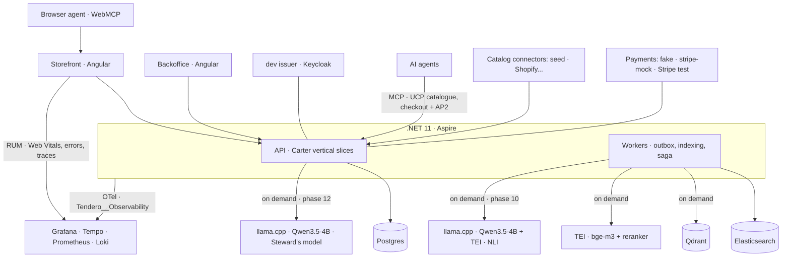
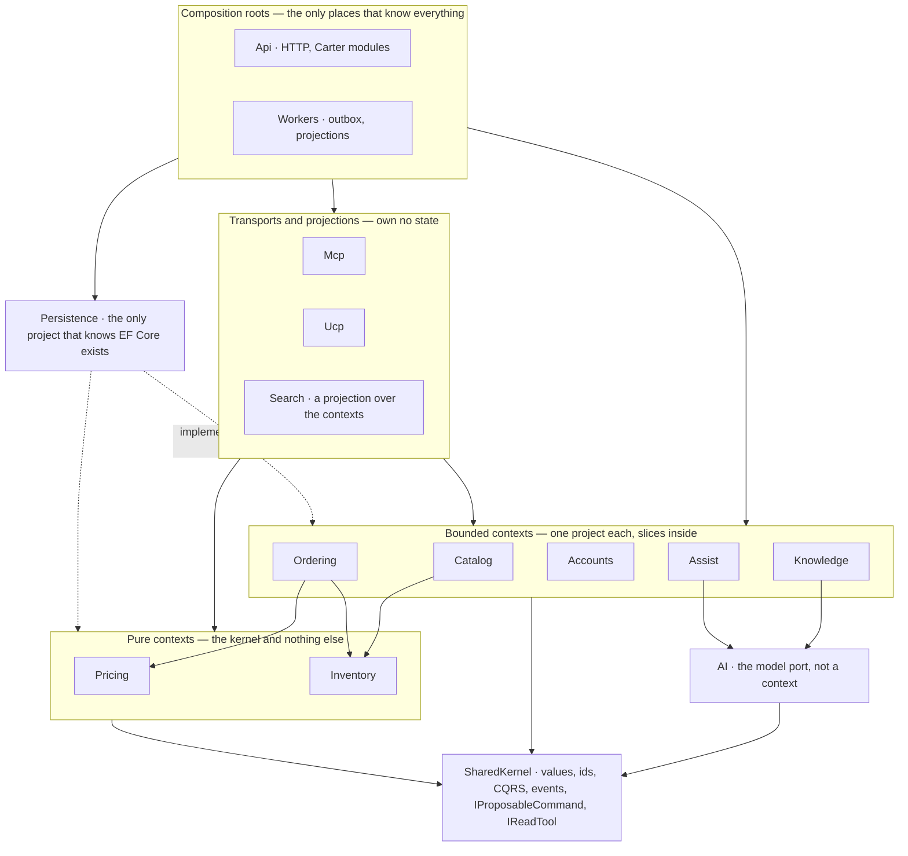
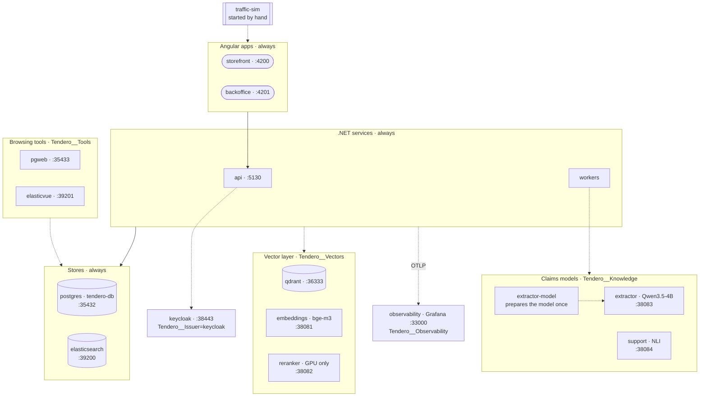

<h1 align="center">
  
</h1>

<p align="center">
  <a href="https://github.com/juanluelguerre/tendero/actions/workflows/ci.yml"></a>
  <a href="docs/search-evaluation.md"></a>
  <a href="https://dotnet.microsoft.com"></a>
  <a href="https://aspire.dev"></a>
  <a href="https://angular.dev"></a>
  <a href="https://www.typescriptlang.org"></a>
  <a href="LICENSE"></a>
  <a href="https://elguerre.com"></a>
</p>

---

> **A reference implementation of the Universal Commerce Protocol in .NET.** When
> this was written (2026-09-27), UCP's official SDKs were Python and JavaScript, and
> we found no .NET implementation of it at all. Tendero implements it in the open:
> discovery (`/.well-known/ucp`, derived from code, never hand-written), the catalogue,
> and **checkout with AP2 mandates**. That covers the shop's signature over every
> checkout, SD-JWT mandates verified against terms the shop signed, a scope frozen
> onto the order, and the shop's own rules for agents. It all runs over REST and MCP,
> and every answer is validated against UCP's own JSON Schemas at release 2026-08-25.
> It also ships a vendor extension of its own (`com.elguerre.tendero.knowledge`).
> Nothing is a mock: it sits on a real shop with a real checkout, stock and returns.
> Start with [docs/mcp.md](docs/mcp.md) and ADRs
> [0039](docs/adr/0039-ucp-checkout-is-a-session-an-agent-owns.md),
> [0040](docs/adr/0040-a-mandate-is-verified-against-terms-the-shop-signed.md) and
> [0022](docs/adr/0022-an-agent-is-a-principal-not-a-customer.md).

**Tendero** is Spanish for *shopkeeper*: the corner-shop owner who knows every
customer, recommends what actually fits, and remembers what you bought last
time. This project builds that shopkeeper as software — an AI-native ecommerce
platform in **.NET 11 + Aspire** and **Angular 22**, with a fully self-hosted AI
stack (Text Embeddings Inference, Qdrant, Elasticsearch and llama.cpp) that runs
on Docker at zero cost.

Most AI demos are Python notebooks. Tendero explores what **production-grade AI
engineering looks like in .NET**: hybrid search with regression tests, an
AI-enriched multilanguage catalog with human review, agent-ready commerce
(UCP/MCP), and observability for every token spent. It doubles as the companion
code for a blog series on AI architecture.

**Home page: [tendero.elguerre.com](https://tendero.elguerre.com)** — what Tendero is for, a
41-second film, and its architecture at two zoom levels.

**Contents** ·
[What runs today](#what-runs-today) ·
[Architecture](#architecture-at-a-glance) ·
[Getting started](#getting-started) ·
[The local stack](#the-local-stack-aspire) ·
[The API contract](#the-api-contract-from-c-to-typescript) ·
[Everyday commands](#everyday-commands) ·
[Project structure](#project-structure) ·
[Testing](#testing-strategy) ·
[Roadmap](#roadmap)

## What runs today

Phases 0–12 of [the board](docs/delivery-plan.md) are in, and so is most of a
redesign of both frontends. The shop works end to end on a 120-product
catalogue; a browser agent can shop in it, and an external agent can read its
catalogue and **buy** over MCP or UCP:

> Search it, put two things in a basket, and the cart shows one discount applied
> and **four suppressed, each with the reason the engine gave**. Pay with the
> card that declines and nothing happens — no order, no stock held, the basket
> untouched. Pay with the good one and stock is reserved and the order confirms
> itself through the outbox. Ship it: the money is captured and the shelf goes
> 4 → 2. Deliver it, send one back, and receiving puts the shelf at 3 before a
> euro moves.

- **Search.** Lexical search (BM25, one index per language) is the permanent
  fallback. **Hybrid search** — `bge-m3` embeddings in Qdrant, fused with BM25
  and reranked — degrades to it byte for byte, and with the reranker scores
  0.831 es / 0.843 en against lexical's **0.692 / 0.748**, on a golden set of 52
  queries per culture that a CI gate holds. It stays off by default: it still
  shows ten products for queries the shop has nothing for, and the reranker
  needs a GPU. [docs/search-evaluation.md](docs/search-evaluation.md) has the
  numbers and why the older ones are not comparable.
- **Product claims with a source** (phase 10). A small local model reads each
  description and proposes what it states, every claim quoting the exact words
  it rests on and scored for support by an NLI model. A person approves or
  rejects, and only then does the catalogue change.
- **Agents at the till** (phase 11). An agent opens a UCP checkout session it
  owns; with AP2 negotiated, the shop signs the checkout and the platform signs a
  mandate once the person consents. The shop verifies it, charges exactly what
  was approved, and applies its own rules on top: suspended agents place
  nothing, a cap per order follows how far the shop trusts the agent, and there
  is a ceiling on orders per hour.
- **Steward, the backoffice copilot** (phase 12). Ask it about sales, stock,
  returns or the catalogue in Spanish or English: it reads the shop through six
  typed reads, each owned by its context, and what they return is drawn as tables
  the shop's own code builds. Ask it for a change and it **proposes commands** —
  never prose, never a write — that a person reviews and approves in bulk, each
  with its value before and after and an audit row naming who proposed and who
  approved (ADR 0019). It runs on a local 4-billion-parameter model, about two
  seconds a turn on a laptop GPU, measured by a suite that compares what it
  stored with what it should have — no judge model
  ([docs/analysis/steward-models.md](docs/analysis/steward-models.md)). With no
  model answering, the backoffice is unchanged.
- **Pictures, and a catalogue model that can hold them** (phase 13a). The local model answers closed questions about a product's picture
  — how many pieces, what colour — and code, not the model, writes the claim a
  person approves; a colour it is sure does not match raises a *doubt* about the
  picture, which is not a claim about the product. Two things in the model moved
  to make that honest: **a category declares its products' attributes**, so a
  bag is never offered a lamp's, and says which of them a product must have —
  a product without one is *incomplete*, shown and never refused (ADR 0056) —
  and **a picture says what it shows**
  — `COLOR: BLACK` — so a variant has no picture of its own, a colour has as
  many as say so, and every size of it shares them (ADR 0057;
  [docs/analysis/catalogue-model.md](docs/analysis/catalogue-model.md) sets the
  model beside Shopify's, Amazon's and Zalando's).
- **Searching with a picture** (phase 13a): a camera in the storefront's search
  box, where the shop can be. SigLIP 2, exported by us and run inside the process, embeds the
  catalogue's pictures into a collection of their own — one point a picture,
  keyed on the hash of its bytes, so a shared picture is embedded once and a
  price change embeds nothing. `POST /api/search/by-image` takes a photograph
  and `GET /api/search/pictures` takes words; neither is a leg of the search
  the gate measures, and a shopper's picture is never kept (ADR 0058). Measured
  alone, words against the pictures rank about as the lexical index and, for a
  *kind* of product, above the fused search
  ([docs/search-evaluation.md](docs/search-evaluation.md)). Without the model's
  folder the shop has no visual search, says so, and is otherwise unchanged.
- **The redesign.** The backoffice is organised by job — a side rail, one
  index-and-pane pattern for every list, a command palette — and its home is a
  dashboard of the whole shop at a glance: tabs per area, a full-screen wall,
  and every figure computed by the context that owns it (ADR 0048). The
  storefront gained its department menu, campaigns and a wider layout.

**2,397 backend tests (2,371 green, 26 skipped with a reason), 743 frontend
tests and 74 browser tests** (2026-10-05). What is next is Tino, the storefront's
shopping assistant (phase 12b).

## Architecture at a glance



Everything drawn runs today; *on demand* is a resource a switch starts
([below](#the-local-stack-aspire)). GenAI calls are traced and metered through
OpenTelemetry into the Grafana stack, one row per call. The C4 view of the same system, held to the
AppHost by a script, is in [docs/c4/](docs/c4/README.md).

Key principles:

- **Seven bounded contexts that share no entities** — `Catalog`, `Pricing`,
  `Inventory`, `Ordering`, `Accounts`, `Knowledge` (claims a model proposes
  and a person approves, ADR 0018) and `Assist` (commands a model proposes and a
  person decides, ADR 0052); `Search` is a projection over them, not a context. A crossing carries values or an event record, never a
  reference: an order snapshots the product's name and price, and stock is keyed
  on a SKU so inventory never learns what a product is (ADR 0014).
- **The outbox is the process manager.** Placing an order holds stock, failing
  to hold it cancels the order, and cancelling gives both the stock and the
  payment hold back — every arrow an ordinary event handler, no saga framework
  (ADR 0024).
- **Ports and adapters at every boundary**, each with an abstract contract suite
  every adapter inherits: catalog connectors, allocation strategies, tax
  calculators, shipping rates, payment providers, identity issuers. The `seed`
  connector, the `fake` payment provider and a development OIDC issuer are the
  defaults — clone and run, no sign-ups.
- **Three agent surfaces, three trust models.** WebMCP runs in the shopper's
  tab and inherits their session; the MCP server's own tools and UCP's catalogue
  are read-only and open; UCP + AP2 is server to server with its own principal
  and a signed mandate (ADRs 0039, 0040 and 0022). Not alternatives — each
  answers a different question.
- **The identity provider is a port.** The API only ever validates tokens
  (OIDC discovery, JWKS, signed JWT); a development issuer signs them on a fresh
  clone and Keycloak does with one switch, behind one contract suite (ADR 0017).
- **Every AI feature has a non-AI path, and the degradation is tested.** Lexical
  search answers when the vector layer is down; claims come from rules when no
  model runs; the shop is unchanged in a browser without WebMCP.
- **OpenAPI is the single source of the API's shape** — the frontends' types are
  generated from it, never written by hand ([below](#the-api-contract-from-c-to-typescript)).
- **Multilanguage by design** (es/en): per-culture indexes with native
  analyzers, `LocalizedText` everywhere user-facing, and an explicit `?culture=`
  that beats `Accept-Language` because an agent has no browser locale
  (ADR 0013).

### Which architecture this is

**Not Clean Architecture, and not Onion** — there are no `Application`,
`Domain` and `Infrastructure` projects stacked across the whole system. It is a
**modular monolith of bounded contexts**, each a project of its own, each
organised inside as **vertical slices**, reaching everything outside itself
through **ports and adapters**, around a **pure domain**. From Clean it keeps the
one idea that matters — *dependencies point inward* — and drops the horizontal
layers. Architecture tests compute every arrow below by reflection; a reference
that should not exist fails the build, not a review.



Solid arrows are project references; the dotted ones are `Persistence`
implementing ports the contexts declare — it depends on them, never they on it.

Inside a context, every feature is one folder:

```
src/Catalog/
  Domain/                      # aggregates, values, events — references the kernel only
  Features/
    ImportProducts/            # one slice: command, validator, handler, endpoint, together
    PublishProduct/
    ListProducts/              #   …and FindProductsTool, the read a model may make of it
  Ports/                       # what the context needs from outside, said in its terms
  Adapters/  Connectors/       # the adapters that are the context's own to write
```

| The piece | What it is best at | Why here, and what it costs |
|---|---|---|
| **Modular monolith** | One deployable, one transaction where one is wanted, boundaries a compiler checks | A shop's contexts change together and are read together; services would buy operational cost for an independence nobody needs yet. *Cost*: one process scales as one, and the discipline is tests, not a network. |
| **Bounded contexts that share no entities** (ADR 0014) | Each context can change its model without asking | An order snapshots a product's name and price; stock is keyed on a SKU and never learns what a product is. *Cost*: values are copied across a crossing, and a crossing has to be designed. |
| **Vertical slices** (ADR 0001) | A feature is read, changed and deleted in one folder | The unit of change in a shop is a feature, not a layer. Slices never reference each other. *Cost*: a little duplication between slices, by choice — shared behaviour goes down to the kernel or out to a port. |
| **Ports and adapters** (ADR 0003) | Swapping what is outside without touching what is inside; a contract suite every adapter inherits | Catalogue sources, payments, identity, models, search engines are all things with credible alternatives. `Ports/` holds *what the context needs*, in its own words — a repository is one, a payment provider is another — which is why there is no `Repositories/` folder and no `Port` suffix: the folder already says it. *Cost*: an interface per boundary, even with one adapter today. |
| **A pure domain** (invariant 4) | Rules testable with properties and no database | `Pricing` and `Inventory` reference the kernel and nothing else, which is what makes the promotion engine and the allocation strategies provable. *Cost*: no EF attribute, no HTTP type, ever — mapping lives in `Persistence`. |
| **CQRS with our own dispatchers** | One pipeline every command goes through: validation, audit, handler | The audit and the proposals depend on it — an approved proposal runs exactly what a click runs. Hand-written, because MediatR's licence changed (the licensing policy). *Cost*: forty lines we own. |
| **Events through an outbox** (ADR 0024) | Side effects that survive a crash and never run inside a request | Indexing, the stock saga, projections and model calls are all handlers of events a transaction wrote. *Cost*: eventual consistency, and a worker to run. |
| **A context publishes a port; another uses it blind** (ADRs 0052, 0054) | A copilot that can read and propose across the shop while referencing none of it | `Assist` runs other contexts' commands through `IProposableCommand` and reads them through `IReadTool`, both in the kernel: each context decides what a model may propose and read of it. *Cost*: a little model-facing code in each context. |

Full plan: [docs/initial-plan.md](docs/initial-plan.md) ·
Architecture: [docs/architecture.md](docs/architecture.md) ·
Domain model, generated from the code: [docs/domain-model.md](docs/domain-model.md) ·
ADRs: [docs/adr/](docs/adr/) ·
Design system: [design/DESIGN.md](design/DESIGN.md) ·
Glossary: [docs/glossary.md](docs/glossary.md) — NDCG@10, BM25, UCP, the outbox
and the rest of the terms this README uses without stopping to define them

## Getting started

### Prerequisites

| | why this exact version |
|---|---|
| **.NET 11 SDK, preview** | `global.json` pins a prerelease floor. `11.0.100` plus `allowPrerelease` resolves *nothing* on a preview-only machine: roll-forward only rolls up, and a preview sorts below its own release. |
| **Node 24** (`.nvmrc`) | Angular 22 requires `^22.22.3 \|\| ^24.15.0 \|\| >=26.0.0`. Node 22.21 fails. |
| **Docker** | Every backing service is a container. The default stack pulls Postgres and Elasticsearch, about 2.5 GB the first time; the optional layers below pull more, and each says how much. Docker Desktop on Windows needs at least 4 GB for its WSL2 backend: Elasticsearch alone asks for a 1 GB heap. |
| **An NVIDIA GPU** — optional | Only for search by meaning at full speed and for the reranker. Without one, the embeddings run on the CPU and the reranker stays off; nothing else changes. |

The Aspire CLI is **not** required: the AppHost is an ordinary project, started
with `dotnet run` or F5.

The repository runs on **Linux and Windows**. Nothing in the code assumes a
platform — every path is built with `Path.Combine` — but the setup commands
differ.

**Linux / macOS**

```bash
curl -sSL https://dot.net/v1/dotnet-install.sh | bash -s -- --channel 11.0 --quality preview
export PATH="$HOME/.dotnet:$PATH"          # add it to your shell profile

nvm install && nvm use                     # reads .nvmrc
```

**Windows (PowerShell)**

```powershell
winget install Microsoft.DotNet.SDK.Preview

# nvm-windows does NOT read .nvmrc — pass the version explicitly
nvm install 24
nvm use 24
```

Use winget, not `dotnet-install.ps1`. On Windows that script ignores
`%USERPROFILE%\.dotnet` and installs into `%LOCALAPPDATA%\Microsoft\dotnet`,
which is a second dotnet root: it only exists on the PATH of the shell that ran
the script, and Rider and Visual Studio keep resolving the release SDK next to
it. winget installs the same build into `C:\Program Files\dotnet` beside the
10.x SDKs, so `global.json` picks it up everywhere, including the IDE.

### Run it

```bash
git clone https://github.com/juanluelguerre/tendero.git
cd tendero
(cd frontend && npm ci)          # once, and again when package-lock.json changes
dotnet tool restore              # EF tools and Stryker, pinned
git config core.hooksPath .githooks   # once: the repository's own git hooks (a commit message carries no attribution trailer)

dotnet run --project src/AppHost
```

Working on it with Claude Code, the repository brings its own setup:
`.claude/settings.json` (a guard that refuses a commit with an attribution
trailer, and a .NET build while the stack holds `src/*/bin`, plus a
confirmation before any commit or push), the skills `hand-mutation` and
`phase-close`, the read-only `conventions-reviewer` agent, and the Postgres
MCP server in `.mcp.json` ([Profiling the database](#profiling-the-database-from-an-ai-assistant-mcp)).

The `npm ci` is a prerequisite in the way `dotnet restore` is: the AppHost does
not install packages on every start, because two installers over one
`node_modules` took five minutes per start where the dev servers alone take four
seconds.

The Aspire dashboard opens at **http://localhost:15130** (the console prints a
login link with its token). The workers apply the migrations and create the
search indexes at start; when the API is healthy, open:

| | |
|---|---|
| Storefront | http://localhost:4200 |
| Backoffice | http://localhost:4201 |
| API · OpenAPI document | http://localhost:5130 · `/openapi/v1.json` |
| Aspire dashboard | http://localhost:15130 |

In Visual Studio or Rider, start **`ElGuerre.Tendero.AppHost`** with the `https`
profile; the others are in [Which switches for which job](#which-switches-for-which-job).

### First steps in the shop

A fresh database has no products. Import the sample catalogue and publish it:

```bash
curl -X POST http://localhost:4200/api/catalog/import \
     -H 'Content-Type: application/json' -d '{"source":"seed"}'
```

Imported products land as `Draft`, and **only `Active` products are indexed and
sold**: importing never publishes, because the review stage is the point
(ADR 0012). Publish them from the backoffice's review queue, signed in as the
shopkeeper.

The development issuer signs a token for any of its seeded identities — no
passwords, only on Development:

| Who | Role | Where |
|---|---|---|
| `juanlu` | shopkeeper | the backoffice |
| `ana` | shopper | the storefront's account and orders |
| `claude-desktop` · `claude-desktop-test` | agent (the second one places test orders) | MCP and UCP, see [docs/mcp.md](docs/mcp.md) |

**An agent needs nothing published on the internet to buy here locally.** Its
token comes from the development issuer, the platform profile the shop fetches
may live at any `localhost` address, and a test credential pays with the
sandbox handler. The one setting that names a public address,
`Ucp:OwnSchemasUrl`, is empty on purpose and stays empty on your machine: it
is where the shop's own UCP extension is published when the shop is deployed
for agents you do not control, and it changes nothing a local run can show
([docs/mcp.md](docs/mcp.md), *An agent of your own, on your own machine*).

**To see the browser's own agent surface**, WebMCP, turn on
`chrome://flags/#enable-webmcp-testing` (the same in Edge) and relaunch: the
storefront's tools appear under DevTools → Application → WebMCP — seven
registered from script and one that is the search form itself, declared in its
markup (experimental) — and the *Model Context Tool Inspector* extension calls
them by hand ([docs/mcp.md](docs/mcp.md), *Seeing the browser's tools*).

If search ever comes back empty — Elasticsearch runs **without a volume** on
purpose, so a recreated container loses its documents while Postgres keeps the
catalogue — rebuild the index from Postgres instead of reimporting:

```bash
curl -X POST http://localhost:4200/api/search/reindex
```

To give the shop some life, start **`traffic-sim`** from the dashboard:
simulated shoppers in headless browsers and agents over MCP and UCP, from one
declared model and one seed (ADR 0037).

## The local stack (Aspire)

`src/AppHost/AppHost.cs` declares every process and container Tendero runs on.
**Everything is declared always**, so the dashboard lists the whole system even
from an IDE that sets no variables; what changes is what **starts by itself**.
Each optional layer has one switch, read when the AppHost starts, and that
switch decides both things at once: whether the containers start, and whether
the API and the workers are handed their addresses. Starting a container by hand
from the dashboard gives you its own UI, but wires nothing to it — restart with
the switch for that.



Solid edges are always wired; dotted ones only under their switch, and an edge
to a group means every resource in it. **Nothing waits for an optional layer**: a vector layer or a model that is missing or
slow means search degrades to lexical and claims come from rules, never a
service that refuses to start.

### What each resource is for

| Resource | Image / project | Starts | What it is for |
|---|---|---|---|
| **postgres** · `tendero-db` | `postgres:18.3` | always | The source of truth for every context. A named volume (`tendero-postgres-data`), so the catalogue, orders and customers survive a restart. |
| **elasticsearch** | `elasticsearch:9.5.0` | always | Lexical search, one index per culture with native analyzers. A plain container, not an Aspire integration: that package declared no licence and pinned the 8.x client (ADR 0006). No volume: the index is a projection rebuilt from Postgres. |
| **api** | `ElGuerre.Tendero.Api` | always | Every endpoint (Carter vertical slices), the OpenAPI document, the MCP server at `/mcp`, UCP's discovery and checkout, and in Development the OIDC development issuer. |
| **workers** | `ElGuerre.Tendero.Workers` | always | Migrates the database and creates the search indexes at start, then drains the outbox: the stock saga, indexing, vectors and claims. Every side effect runs here, never inside a request. |
| **storefront** · **backoffice** | Vite dev servers (`npm run serve:*`) | always | The two Angular apps, with the API's address injected by Aspire into their proxy — no URL is written in application code. The `*-installer` children stay unstarted on purpose (see `npm ci` above). |
| **qdrant** | `qdrant/qdrant` | `Tendero__Vectors` | The vector store for search by meaning and for similar products. |
| **embeddings** | Text Embeddings Inference, `bge-m3` pinned by revision | `Tendero__Vectors` | Turns product texts and queries into vectors. On the GPU when Docker can reach one (1.3 GB of VRAM), on the CPU otherwise (3.7 GiB of RAM); 2.2 GB of weights on its first start. `Tendero__Inference__Device=auto\|cpu\|gpu` overrides the choice. |
| **reranker** | TEI, `bge-reranker-v2-m3` | `Tendero__Vectors` **and** a GPU | Reorders the head of a hybrid search. On a CPU it takes ten seconds against a budget of 800 ms, so there it never starts. |
| **extractor-model** | `llama.cpp:full` | `Tendero__Knowledge` | Runs once: downloads Qwen3.5-4B at its checked revision, converts and quantizes it into a volume, and verifies its SHA-256. About 9 GB downloaded the first time. |
| **extractor** | `llama.cpp:server` | `Tendero__Knowledge` | Reads each product's description and proposes claims, each quoting its evidence. About 30 s a product on a CPU — a worker's pace. |
| **support** | TEI, an NLI model | `Tendero__Knowledge` | Scores how well the quoted evidence supports each claim, in 0.07 s. |
| **keycloak** | `keycloak:26.6` | `Tendero__Issuer=keycloak` | The real identity provider, with the committed realm in `keycloak/` imported. With the switch the API trusts it instead of the development issuer — one configuration value, no code path (ADR 0017). Admin console: `admin` / `admin`. |
| **observability** | `grafana/otel-lgtm` | `Tendero__Observability` | Grafana, Tempo, Prometheus and Loki behind one collector, which forwards everything to the Aspire dashboard too: the full mode adds, never takes away (ADR 0036). Grafana without sign-in at http://localhost:33000. About 0.9 GB. |
| **pgweb** | `sosedoff/pgweb` | `Tendero__Tools` | A SQL box over the database, already connected. |
| **elasticvue** | `cars10/elasticvue` | `Tendero__Tools` | A browser for the search indexes. |
| **traffic-sim** | `ElGuerre.Tendero.TrafficSim` | by hand, from the dashboard | Simulated shoppers and agents (ADR 0037). Reproducible from `Parameters:traffic-sim-seed`; a simulated day lasts an hour. |

Every fixed port is deliberately **off its default** — 5432 and 9200 are
somebody's work services — and below 49152, where Windows reserves ports that
move on every restart. Every container carries a memory and CPU limit sized from
a measurement, and a Compose label so Docker Desktop groups them under
`tendero`. [src/AppHost/README.md](src/AppHost/README.md) has the reasons.

### Which switches for which job

| You want to… | Switch | Costs on first start |
|---|---|---|
| work on the shop, the backoffice or the API | nothing | ~2.5 GB of images |
| work on search by meaning, similar products or ranking | `Tendero:Vectors=true` | 2.2 GB of weights; a GPU for the reranker |
| work on product claims (phase 10) | `Tendero:Knowledge=true` | ~9 GB to prepare the model, 6 GB of RAM to serve it |
| see traces, metrics and logs across a flow | `Tendero:Observability=true` | ~0.9 GB |
| try the real identity provider, or edit the realm | `Tendero:Issuer=keycloak` | ~0.5 GB; the API waits for Keycloak, about a minute |
| look inside the database or the indexes | `Tendero:Tools=true`, or press *Start* on `pgweb` / `elasticvue` | small |
| compare the two browser telemetry adapters | `Parameters:browser-telemetry=otel\|faro\|noop` | — |
| run the embeddings on a given device | `Tendero:Inference:Device=auto\|cpu\|gpu` | — |

They are ordinary .NET configuration keys, read by the AppHost when it starts,
so any source of configuration sets them. In an environment variable the colon
becomes a double underscore (`Tendero__Vectors`).

**From a terminal**, for one run:

```bash
Tendero__Vectors=true dotnet run --project src/AppHost              # bash
$env:Tendero__Vectors="true"; dotnet run --project src/AppHost     # PowerShell
dotnet run --project src/AppHost -- --Tendero:Vectors=true         # any shell
```

**For every run on your machine, whatever launches it** — Visual Studio, VS Code,
Rider or the terminal — put them in the AppHost's user secrets. They are a JSON
file in your user profile (`%APPDATA%\Microsoft\UserSecrets\tendero-apphost\` on
Windows, `~/.microsoft/usersecrets/tendero-apphost/` elsewhere), outside the
repository, so nobody else's stack changes and there is nothing to commit:

```bash
dotnet user-secrets set Tendero:Vectors true --project src/AppHost      # on from now on
dotnet user-secrets set Tendero:Knowledge true --project src/AppHost    # they add up
dotnet user-secrets list --project src/AppHost                          # what is set
dotnet user-secrets remove Tendero:Vectors --project src/AppHost        # off again
```

Use `remove`, never `clear`: Aspire keeps its own generated values in the same
file (the Postgres password among them), and clearing it would give the
database a new password its volume does not know.

**Visual Studio and Rider** offer the launch profiles in
`src/AppHost/Properties/launchSettings.json` in the run drop-down:

| Profile | Starts |
|---|---|
| `https` | the default stack |
| `https-vectors` | plus the vector layer: search by meaning, similar products, the reranker on a GPU |
| `https-knowledge` | plus the claims models: the extractor and the support scorer |
| `https-advanced` | plus both: every AI stage on — their containers' memory limits add up to about 14 GB on a CPU |
| `https-all` | every AI piece at once: the vector layer, the claims models, Steward's model and Tino on it — not the Grafana stack. Memory and VRAM added up have not been measured on one machine; on a GPU it is the embeddings, the reranker and Steward's model (about 4.8 GB) sharing the card |
| `https-steward` | plus Steward's local model (6 GB): without it the panel opens and answers that no model is available |
| `https-tino` | plus Tino, the storefront's assistant: the same local model as Steward's and the support scorer. Only on a GPU — without one the door stays in the header and says *not available* |
| `https-observability` | plus the Grafana stack |
| `http` | the default stack, with the dashboard over plain HTTP |

The rarer switches (Keycloak, the tools) are not profiles on purpose —
every combination would be one more entry in the drop-down. Set them in user
secrets, and they apply under whichever profile you pick. A profile's
environment variables win over user secrets, so a profile can also turn one off
for a run (`"Tendero__Vectors": "false"`).

**VS Code**, with the [Aspire extension](https://aspire.dev/get-started/aspire-vscode-extension/),
launches the AppHost from a `.vscode/launch.json` configuration of type
`aspire`, which takes the switches in `env`:

```json
{
  "type": "aspire",
  "request": "launch",
  "name": "Tendero: vectors",
  "program": "${workspaceFolder}/src/AppHost",
  "env": { "Tendero__Vectors": "true" }
}
```

The switches combine. With none of them, every AI stage is off and the shop runs
on its non-AI paths — which is exactly what a default F5 should be.

### Profiling the database from an AI assistant (MCP)

The stack's Postgres is always on **`localhost:35432`**, database `tendero-db`,
user `postgres`, and Elasticsearch on **`localhost:39200`**. The ports are fixed
in `src/AppHost/AppHost.cs` so that a tool configured once keeps working, and
they are not 5432 and 9200 so that they do not collide with the database and
the search engine a developer already runs for work.

`.mcp.json` declares **`tendero-postgres`**, [Postgres MCP Pro](https://github.com/crystaldba/postgres-mcp)
(MIT, image `crystaldba/postgres-mcp:0.3.0`, run with Docker; a tool beside the
app, not a dependency of it). It gives an assistant such as Claude Code the
schema, `EXPLAIN` plans, the slowest queries, index advice and a health check
over the running stack's database. It runs **read-only**
(`--access-mode=restricted`): read-only transactions and a time limit, so a
`CREATE` or `UPDATE` is refused. To set it up:

1. **The connection string**, with the password Aspire generated and keeps in
   the AppHost's user secrets (`Parameters:postgres-password`). Put it in an
   environment variable that Claude Code reads when it starts, never in a file
   in the repository:

   ```bash
   dotnet user-secrets list --project src/AppHost | grep postgres-password
   export TENDERO_PG_URL="postgresql://postgres:<that password>@localhost:35432/tendero-db"
   ```

   On Windows, `setx TENDERO_PG_URL "postgresql://…"` keeps it for new
   terminals. Without the variable, the server starts with no password and
   says so on its first call.
2. **The query statistics, once.** The AppHost starts Postgres with
   `pg_stat_statements` loaded (`shared_preload_libraries`), and the extension
   has to be created in the database once. Run it from pgweb (`Tendero:Tools=true`,
   or *Start* on `pgweb`) or from the container:

   ```sql
   CREATE EXTENSION IF NOT EXISTS pg_stat_statements;
   ```

   Without it, the top-queries and workload tools say the extension is
   missing, and the rest still work. `hypopg` (hypothetical indexes) is not in
   the image, so index advice that needs it says so.
3. **Start the stack, then Claude Code** in the repository. It asks once
   whether to trust the project's MCP servers; `/mcp` shows `tendero-postgres`
   connected. Ask it, for example, *"which queries cost the most since the
   stack started, and what does the plan of the worst one say?"*

**Elasticsearch has no MCP server here, on purpose.** Elastic's standalone MCP
server is deprecated. What replaces it, the Agent Builder MCP endpoint, lives
in **Kibana** (9.2 and later), which this stack does not run; a third-party
reading of Elastic's subscriptions puts it in the Enterprise tier, not checked
against Elastic's own page (2026-10-14). For the index, use what is already
there: **elasticvue** (`localhost:39201`) to look, and Elasticsearch's own REST
API on `localhost:39200` to profile. An assistant can call it directly, for
example `POST /products_es/_search` with `"profile": true` (one index a
language: `products_es`, `products_en`), `GET /_nodes/stats`, or
`GET /_nodes/hot_threads`. Never point any of this at `localhost:9200`: that is
a developer's own Elasticsearch, not the stack's.

## The API contract: from C# to TypeScript

**The API's shape has one source, and it is the running API.** No DTO is ever
written twice: the C# records a slice returns define the OpenAPI document, the
document is committed, and the frontends' TypeScript types are generated from it.
Two tests, one on each side, make it impossible for the three to drift.

```mermaid
flowchart LR
    A["C# record returned by a slice<br/>e.g. SalesMix"] -->|ASP.NET Core OpenAPI| B["the document the API serves<br/>/openapi/v1.json"]
    B -->|OpenApiDocumentTests<br/>UPDATE_OPENAPI=1| C["docs/openapi/tendero.json<br/>committed"]
    C -->|npm run generate:api-types<br/>openapi-typescript| D["libs/shared/api/.../generated/schema.ts<br/>committed, never edited"]
    D -->|named per context| E["libs/shared/api<br/>export type SalesMix = Schemas['SalesMix']"]
    E --> F["data-access services<br/>and stores in both apps"]
```



When you change anything a response returns, run the two commands in this order:

```bash
UPDATE_OPENAPI=1 dotnet test tests/Api.Tests   # the API regenerates docs/openapi/tendero.json
cd frontend && npm run generate:api-types       # the types follow the document
```

- **Without the first**, `OpenApiDocumentTests` fails: it boots the API in
  process, asks it for its document and compares it with the committed one. CI
  also asserts the file is unchanged after the tests, so a run with the variable
  left set cannot rewrite it and pass.
- **Without the second**, the frontend CI job regenerates the types and fails on
  any difference.
- **A type reaches a component through `libs/shared/api`**, which names each
  schema once per context (`ordering-contracts.ts`, `search-contracts.ts`…).
  Nobody imports from `generated/`, and nobody writes an interface that mirrors a
  C# record.
- **The same document backs UCP's capability schemas**, so an agent and a
  browser read the same contract.

To ask what an endpoint takes or returns, ask the document rather than reading
the code — through its map, because the whole thing is large:

```bash
node tools/api-map.mjs                    # one line per operation
node tools/api-map.mjs dashboard          # filtered by path, tag or operation id
node tools/api-map.mjs --schema SalesMix  # one schema
```

Two limits worth knowing: an enum crosses the wire by name, never as a number
(ADR 0043), and a strongly-typed id is flattened to a string before it leaves an
endpoint. Authorization is not in the document — each Carter module states its
policy, and `EndpointAuthorizationTests` holds every route to one.

## Everyday commands

```bash
dotnet build -warnaserror Tendero.slnx         # warnings are errors, always
dotnet test                                    # unit, property, contract, architecture, API
dotnet test --filter Category=Integration      # Testcontainers: needs Docker, skips without it
dotnet format --no-restore --verify-no-changes --severity error   # what CI checks

cd frontend
npx nx run-many -t lint test build             # boundaries, tokens, unit tests, builds
npx playwright install chromium                # once
npx nx e2e storefront-e2e                      # needs the stack up
npx nx e2e backoffice-e2e
```

`npx nx` when you type it, `nx` inside a `package.json` script — Nx is a local
dependency, and the prefix is about who resolves the command
([frontend/README.md](frontend/README.md)).

Generated documents, each with its own regenerate-and-diff in CI:

```bash
UPDATE_DOMAIN_MODEL=1 dotnet test --project tests/Architecture.Tests  # docs/domain-model.md
node tools/c4.mjs              # docs/c4: validates the model against the AppHost, redraws it
node tools/tracking-plan.mjs   # docs/telemetry: the events and the browser's event types
```

**The search quality gate** runs against a disposable Elasticsearch, never one
you work with:

```bash
docker run -d --name tendero-es -p 39210:9200 \
  -e discovery.type=single-node -e xpack.security.enabled=false \
  docker.elastic.co/elasticsearch/elasticsearch:9.5.0

dotnet run --project tools/SearchEval -- --elasticsearch http://localhost:39210        # report
dotnet run --project tools/SearchEval -- --elasticsearch http://localhost:39210 --ci   # exits 1 below the thresholds
```

**Mutation testing** runs at every phase close, not per pull request:
`dotnet tool run dotnet-stryker --config-file stryker-config.json
--skip-version-check` from a project's folder ([docs/testing.md](docs/testing.md)).

## Project structure

```
src/
  AppHost/                 # Aspire: every resource, its switch and its limits
  ServiceDefaults/         # OTel, health checks, service discovery
  SharedKernel/            # Money, LocalizedText, ids, AggregateRoot, CQRS, transition tables
  Catalog/                 # products, variants, attributes, categories, connectors
  Pricing/                 # price lists, promotions, campaigns, tax — SharedKernel only
  Inventory/               # warehouses, stock, reservations — SharedKernel only too
  Ordering/                # cart, checkout, orders, payments, returns, the stock saga, the dashboard's figures
  Accounts/                # customers and guests, agents, the audit log's reader
  Knowledge/               # claims with source, support and approval (ADR 0018)
  Assist/                  # Steward: proposals a model makes and a person decides (ADRs 0019, 0052)
  AI/                      # the model port: profiles, one pipeline, one metered row per call (ADR 0053)
  Search/                  # lexical and hybrid search, indexing, vectors, search status
  Mcp/  Ucp/               # the agent surfaces: MCP tools, UCP discovery and checkout, AP2
  DevIssuer/               # OIDC discovery, JWKS and signed tokens, Development only
  Api/  Workers/           # composition roots: HTTP endpoints, the outbox processor
  Persistence/             # the only project that knows EF Core exists
frontend/                  # Nx workspace
  apps/storefront/         # the shop: home, departments, search, product, compare, cart, checkout, orders, account
  apps/backoffice/         # the shopkeeper's: dashboard, review queues, catalogue, promotions, campaigns, stock, orders, returns, agents, audit
  apps/*-e2e/              # Playwright — the thinnest layer of the pyramid
  libs/shared/             # tokens, ui, util, api, i18n, auth, agent, telemetry, a11y
keycloak/                  # the committed realm: users, roles and clients for a fresh clone
brand/  design/            # logo and brand guide; DESIGN.md and tokens.css, the single source of every colour, light and dark
seed/                      # the sample catalogue and its prices, stock and campaigns (es/en)
tools/                     # SearchEval (quality gates), TrafficSim, SeedImages (the product illustrations), api-map, c4, tracking-plan
docs/                      # board, architecture, ADRs, specs, OpenAPI, C4, testing, telemetry
tests/                     # unit, contract, architecture, integration, API
```

Backend features are vertical slices under each context's `Features/`, and
frontend features are folders by theme with a SignalStore for every state with a
life of its own (ADR 0047). Both apps follow the reader's light or dark
preference, and each has its own density: the shop is roomy, the backoffice
dense.

## Testing strategy

| Layer | Tools | What it protects |
|---|---|---|
| Unit | xUnit v3 | Domain invariants and every transition table, walked in full |
| Property-based | CsCheck | The promotion engine over thousands of generated carts — it found a real bug |
| Contract | xUnit abstract suites, UCP's JSON Schemas | UCP's answers against UCP's own schemas; every connector, allocation strategy, tax calculator, shipping rate, payment provider and identity issuer honours its port |
| Architecture | NetArchTest.Rules | Domain never references infra; slices stay independent; `Pricing` and `Inventory` see only the SharedKernel; the Elasticsearch client stays in its adapter |
| Integration | Testcontainers | A real Postgres, Elasticsearch and Qdrant: the outbox drain, the migrations, the commerce loop end to end |
| API in process | `WebApplicationFactory` | The OpenAPI document equals the committed one; every endpoint states who may call it; every handler resolves; the OIDC contract against both issuers |
| Frontend | Vitest | Stores, widgets, agent tools and their degradation, not one hex outside `design/theme.css` across every stylesheet in the repo, and every class a template names either builds or is ours |
| Search quality | Golden set + NDCG@10 in CI | Relevance never regresses silently |
| End-to-end | Playwright | The browser: sign-in, the shopper's and the shopkeeper's paths, the browser agent, accessibility |
| Mutation | Stryker.NET, and a hand mutation per new test | Each test fails when the code it guards is broken, not only when it is absent |

More: [docs/testing.md](docs/testing.md) · [docs/search-evaluation.md](docs/search-evaluation.md)

## Roadmap

The living board — what is next, what each phase evidences, and what was
deferred with its measured number — is
**[docs/delivery-plan.md](docs/delivery-plan.md)**. This is the short version.

| Phase | | Status |
|---|---|---|
| 0 | CI, OpenAPI contract, migrations, Testcontainers, the identity port | ✅ |
| 1 | Variants: the indexed unit is the variant, the returned one the product | ✅ |
| 2 | Localized attributes and taxonomy | ✅ **es 0.860 → 0.943, en 0.720 → 0.937**, measured over the first six products |
| 3 | Price lists, promotions with combination rules, tax | ✅ |
| 4 | Inventory: two warehouses, reservations, the stock saga on the outbox | ✅ |
| 5 | Cart, checkout, payments, returns, the product page | ✅ |
| 6 | WebMCP in the storefront | ✅ the cheapest differentiator — the agent inherits the shopper's session |
| 7 | Accounts, audit, and swapping the dev issuer for Keycloak | ✅ the swap was two environment variables |
| 8 | **Project Rastro**: embeddings, hybrid search, evals | ✅ built and degradable; hybrid + reranker beats lexical, and stays off by default |
| 9 | Read-only MCP server and the UCP manifest | ✅ UCP's catalogue over MCP and REST, validated against UCP's own schemas |
| 9b | Seeing it run: the Grafana stack behind a switch, browser telemetry, a seeded traffic simulator | ✅ a tracking plan a test holds to the code |
| 10 | Knowledge: product claims with source and confidence | ✅ nine models measured before one was chosen; a review queue, specs with source chips, comparisons that say "no data" |
| 11 | UCP transactional, AP2 and Know Your Agent | ✅ **the headline** — checkout over REST and MCP, AP2 mandates verified against terms the shop signed, the shop's own rules for agents, test orders |
| R | The redesign: backoffice by job, storefront navigation, the dashboard | 🚧 measured against a baseline walkthrough |
| 12 | **Steward**, the backoffice copilot | ✅ it proposes commands a person approves, never prose; six typed reads owned by their contexts; a local model measured by a suite with no judge. The hosted profiles and the AI panel wait |
| 12b | **Tino**, the storefront's shopping assistant, with voice and after-sale tools | 🔜 answers only from approved claims, citing each one |
| 13a | Images: a model that reads a picture, claims and doubts from it, the catalogue's model under them, and visual search | ✅ a category declares its attributes; a picture says what it shows; the shop is searched with a picture, and the pictures are a third leg of the search where they are |
| 13c | The kit solver | 🔜 |

## Blog series

Each phase ships with an article, in English, on
[elguerre.com](https://elguerre.com).

| # | Article | Tag |
|---|---|---|
| 00 | [From CocktailDev to Tendero: an AI-native ecommerce platform in .NET](https://elguerre.com/2026/09/16/tendero-ai-native-ecommerce-dotnet/) | `blog/00-from-cocktaildev-to-tendero` |
| 01 | [Why design before code when an AI agent builds the screen in minutes: sketch, mockup and prototype](https://elguerre.com/2026/10/08/design-system-before-code/) | `blog/01-design-before-code` |

Every article links a tag of this repository named after it, `blog/NN-slug`,
cut once its snippets and numbers had been checked against the code. Clone that
tag and you have the tree the article describes, not whatever the project has
become since.

The drafts, and the notebook they are written from, are not published here, and
neither are the articles: those live on the blog. What reaches this repository
on the day an article goes out is the code it describes, under its tag.

## License

MIT — see [LICENSE](LICENSE).
