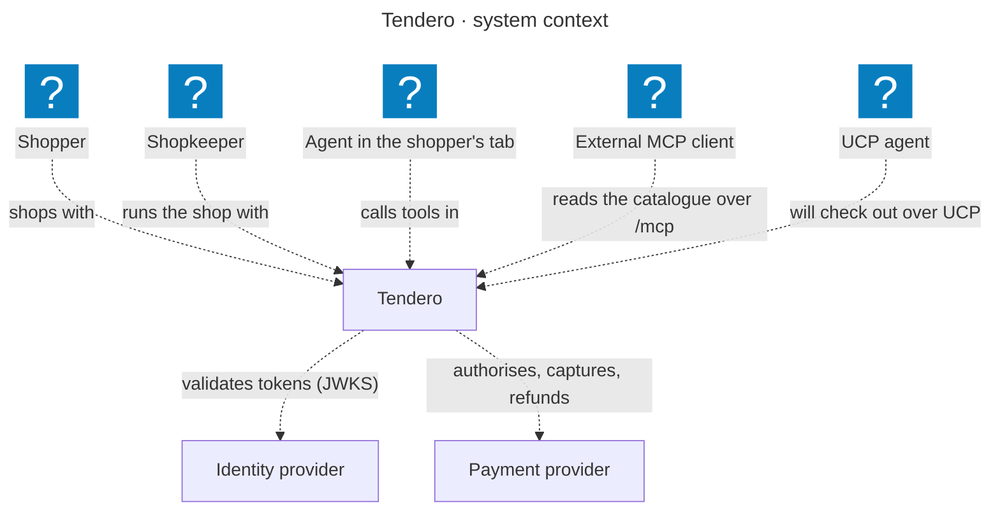
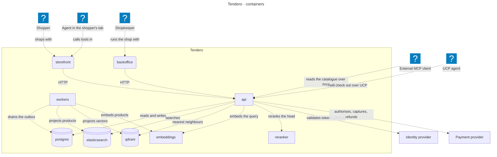

# Tendero in C4

> **Generated — do not edit.** Drawn from [`tendero.c4`](tendero.c4) by
> `node tools/c4.mjs`, which also fails when the model's containers and the
> AppHost's resources disagree (ADR 0035).

Levels 1 and 2 of the [C4 model](https://c4model.com): who uses Tendero, and
the processes and stores it runs on. Level 4 is the domain model, generated
from the code in [`../domain-model.md`](../domain-model.md). Containers tagged
`optional` start only when their capability is configured; the UCP agent is
tagged `planned` for phase 11.

