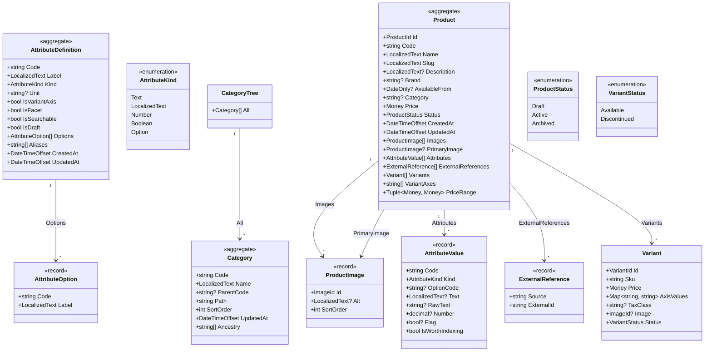
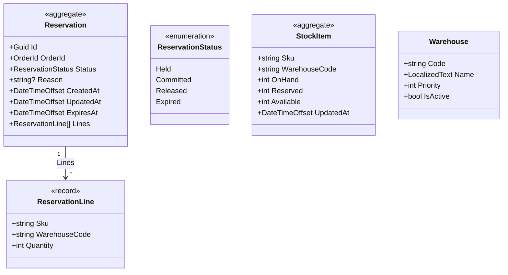
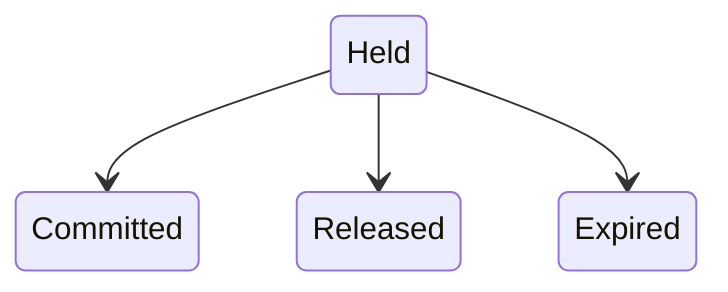
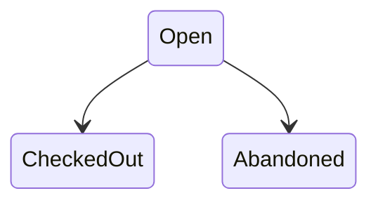
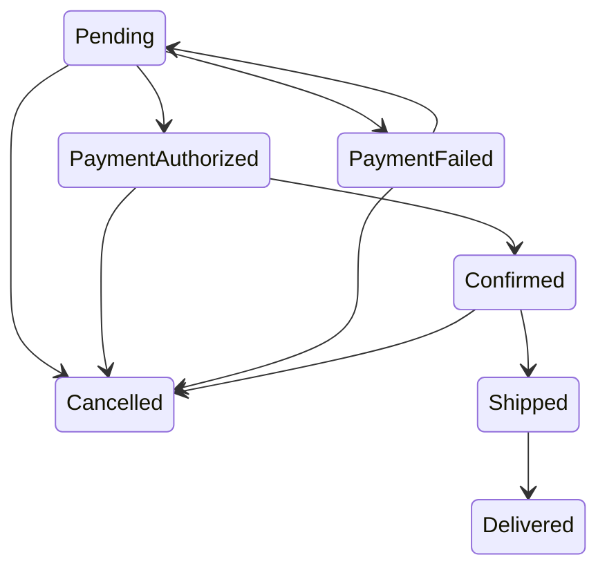
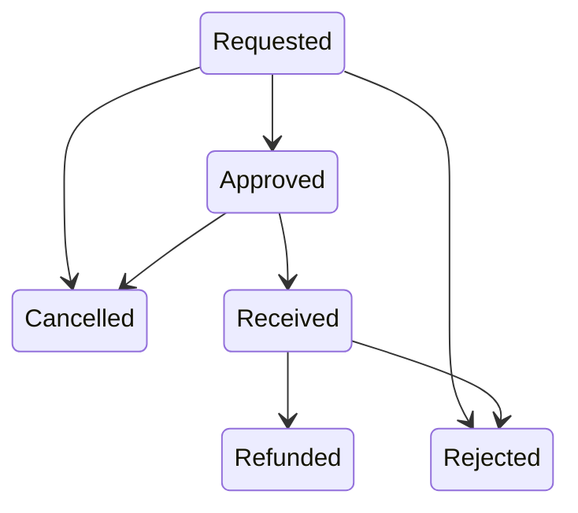
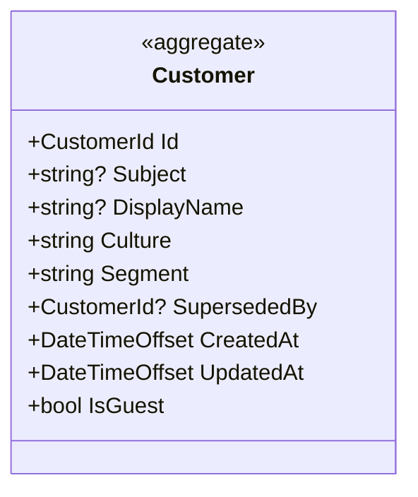

# Domain model

> **Generated — do not edit.** Written from the code by
> `tests/Architecture.Tests/DomainModelDocument.cs`, and a test fails when this
> file and the code disagree. Regenerate it with:
>
> ```bash
> UPDATE_DOMAIN_MODEL=1 dotnet test --project tests/Architecture.Tests
> ```

One section per bounded context, from the public types of its `*.Domain`
namespace. Types from the SharedKernel — `Money`, `LocalizedText`, `Address`
and the strongly-typed ids — appear as property types rather than as boxes,
because every context uses them and drawing them five times says nothing.
Contexts share no entities (ADR 0014), so no arrow crosses a section.

`aggregate` marks a subclass of `AggregateRoot`; `record` marks a C# record.
Events are listed rather than drawn: an aggregate raises them from its
methods, which a diagram of properties cannot show. Every event also carries
`OccurredAt`. The state machines are the aggregates' `TransitionTable`s, read
from the tables themselves (invariant 5).

## Catalog



### Events

| Event | Carries |
|---|---|
| `AttributeDefinitionChanged` | `Code: string` |
| `CategoryChanged` | `Code: string` |
| `ProductArchived` | `ProductId: ProductId` |
| `ProductUpserted` | `ProductId: ProductId` |

## Pricing

```mermaid
classDiagram
    class AmountOffOrder {
        <<record>>
        +Money Amount
        +string Kind
        +string Canonical
    }
    class AppliedDiscount {
        <<record>>
        +string PromotionCode
        +LocalizedText Label
        +Money Amount
        +string EffectKind
        +CombinationPolicy Combination
        +DiscountOutcome Outcome
        +RuleReason? Reason
    }
    class BuyXGetY {
        <<record>>
        +int Buy
        +int Free
        +string Kind
        +string Canonical
    }
    class CartItem {
        <<record>>
        +VariantId VariantId
        +string Sku
        +int Quantity
        +Money CatalogPrice
        +string? CategoryPath
        +string? TaxClass
    }
    class CombinationPolicy {
        <<enumeration>>
        ExclusiveGlobal
        ExclusiveInGroup
        Stackable
    }
    class DiscountOutcome {
        <<enumeration>>
        Applied
        Suppressed
    }
    class FreeShipping {
        <<record>>
        +string Kind
        +string Canonical
    }
    class PercentOffLine {
        <<record>>
        +decimal Percent
        +string Kind
        +string Canonical
    }
    class PriceBook {
        +PriceList[] Lists
    }
    class PriceList {
        +string Code
        +string Segment
        +string Currency
        +int Priority
        +DateTimeOffset? ValidFrom
        +DateTimeOffset? ValidTo
        +PriceListEntry[] Entries
    }
    class PriceListEntry {
        <<record>>
        +string Sku
        +Money Price
    }
    class PriceQuote {
        <<record>>
        +string QuoteId
        +string InputHash
        +DateTimeOffset IssuedAt
        +DateTimeOffset ExpiresAt
        +string Currency
        +string Segment
        +QuotedLine[] Lines
        +AppliedDiscount[] Discounts
        +TaxLineView[] Taxes
        +Money Subtotal
        +Money DiscountTotal
        +Money Shipping
        +Money TaxTotal
        +Money Total
    }
    class PricedCart {
        <<record>>
        +string Currency
        +string Segment
        +PricedLine[] Lines
        +Money Shipping
        +Money Gross
        +Money DiscountTotal
        +Money Net
    }
    class PricedLine {
        <<record>>
        +VariantId VariantId
        +string Sku
        +int Quantity
        +Money UnitPrice
        +string PriceSource
        +string? CategoryPath
        +string? TaxClass
        +Money Discount
        +Money Gross
        +Money Net
    }
    class Promotion {
        <<record>>
        +string Code
        +LocalizedText Name
        +PromotionCondition Condition
        +PromotionEffect Effect
        +CombinationPolicy Combination
        +int Priority
        +string? ExclusivityGroup
        +string? Segment
        +string? CouponCode
        +DateTimeOffset? ValidFrom
        +DateTimeOffset? ValidTo
    }
    class PromotionCondition {
        <<record>>
        +Money? MinimumSubtotal
        +string? CategoryCode
        +string? Sku
        +int? MinimumQuantity
        +string Canonical
    }
    class PromotionEffect {
        <<record>>
        <<abstract>>
        +string Kind
        +string Canonical
    }
    class QuoteValidity {
        <<enumeration>>
        Valid
        Expired
        InputsChanged
    }
    class QuotedLine {
        <<record>>
        +VariantId VariantId
        +string Sku
        +int Quantity
        +Money UnitPrice
        +string PriceSource
        +Money Discount
        +Money Net
    }
    class RuleReason {
        <<record>>
        +string Code
        +LocalizedText Explanation
    }
    class TaxLineView {
        <<record>>
        +string TaxClass
        +decimal Rate
        +Money Base
        +Money Amount
    }
    PromotionEffect <|-- AmountOffOrder
    AppliedDiscount --> RuleReason : Reason
    PromotionEffect <|-- BuyXGetY
    PromotionEffect <|-- FreeShipping
    PromotionEffect <|-- PercentOffLine
    PriceBook "1" --> "*" PriceList : Lists
    PriceList "1" --> "*" PriceListEntry : Entries
    PriceQuote "1" --> "*" QuotedLine : Lines
    PriceQuote "1" --> "*" AppliedDiscount : Discounts
    PriceQuote "1" --> "*" TaxLineView : Taxes
    PricedCart "1" --> "*" PricedLine : Lines
    Promotion --> PromotionCondition : Condition
    Promotion --> PromotionEffect : Effect
```



## Inventory



### Events

| Event | Carries |
|---|---|
| `StockLevelChanged` | `Sku: string`, `Available: int` |
| `StockRejected` | `OrderId: OrderId`, `Reason: string` |
| `StockReserved` | `OrderId: OrderId` |

### Reservation states



## Ordering

```mermaid
classDiagram
    class Cart {
        <<aggregate>>
        +CartId Id
        +CustomerId? CustomerId
        +string Token
        +string Culture
        +string Currency
        +CartStatus Status
        +DateTimeOffset CreatedAt
        +DateTimeOffset UpdatedAt
        +DateTimeOffset ExpiresAt
        +CartLine[] Lines
        +int ItemCount
        +bool IsEmpty
    }
    class CartLine {
        <<record>>
        +ProductId ProductId
        +VariantId VariantId
        +string Sku
        +LocalizedText ProductName
        +LocalizedText? VariantLabel
        +string? ImageId
        +int Quantity
    }
    class CartStatus {
        <<enumeration>>
        Open
        CheckedOut
        Abandoned
    }
    class Order {
        <<aggregate>>
        +OrderId Id
        +CustomerId CustomerId
        +string IdempotencyKey
        +string Culture
        +string Currency
        +OrderStatus Status
        +DateTimeOffset CreatedAt
        +DateTimeOffset UpdatedAt
        +Address ShippingAddress
        +Address BillingAddress
        +OrderShipping Shipping
        +OrderQuote Quote
        +OrderTotals Totals
        +OrderDiscount[] Discounts
        +OrderTax[] Taxes
        +OrderPayment? Payment
        +OrderStop? Stop
        +OrderLine[] Lines
        +Money LinesTotal
        +Money Total
    }
    class OrderDiscount {
        <<record>>
        +string PromotionCode
        +string Label
        +Money Amount
    }
    class OrderLine {
        <<record>>
        +ProductId ProductId
        +VariantId VariantId
        +string Sku
        +string ProductName
        +string? VariantLabel
        +string? ImageId
        +Money UnitPrice
        +int Quantity
        +Money Total
    }
    class OrderPayment {
        <<record>>
        +string Provider
        +string AuthorizationId
        +string? CaptureId
    }
    class OrderQuote {
        <<record>>
        +string QuoteId
        +string InputHash
        +DateTimeOffset IssuedAt
    }
    class OrderShipping {
        <<record>>
        +string OptionCode
        +string Label
        +Money Amount
        +int? EstimatedDays
    }
    class OrderStatus {
        <<enumeration>>
        Pending
        PaymentAuthorized
        PaymentFailed
        Confirmed
        Shipped
        Delivered
        Cancelled
    }
    class OrderStop {
        <<record>>
        +string Code
        +string? Detail
    }
    class OrderTax {
        <<record>>
        +string TaxClass
        +decimal Rate
        +Money Base
        +Money Amount
    }
    class OrderTotals {
        <<record>>
        +Money Subtotal
        +Money DiscountTotal
        +Money Shipping
        +Money TaxTotal
        +Money Total
    }
    class ReturnLine {
        <<record>>
        +VariantId VariantId
        +string Sku
        +int Quantity
        +ReturnReason Reason
        +string? Comment
    }
    class ReturnReason {
        <<enumeration>>
        WrongSize
        NotAsDescribed
        Damaged
        WrongItem
        ChangedMind
    }
    class ReturnRequest {
        <<aggregate>>
        +ReturnRequestId Id
        +OrderId OrderId
        +int Number
        +CustomerId CustomerId
        +ReturnStatus Status
        +string? Resolution
        +Money? RefundAmount
        +string? RefundReference
        +DateTimeOffset CreatedAt
        +DateTimeOffset UpdatedAt
        +ReturnLine[] Lines
    }
    class ReturnStatus {
        <<enumeration>>
        Requested
        Approved
        Received
        Refunded
        Rejected
        Cancelled
    }
    Cart "1" --> "*" CartLine : Lines
    Order --> OrderShipping : Shipping
    Order --> OrderQuote : Quote
    Order --> OrderTotals : Totals
    Order "1" --> "*" OrderDiscount : Discounts
    Order "1" --> "*" OrderTax : Taxes
    Order --> OrderPayment : Payment
    Order --> OrderStop : Stop
    Order "1" --> "*" OrderLine : Lines
    ReturnRequest "1" --> "*" ReturnLine : Lines
```



### Events

| Event | Carries |
|---|---|
| `OrderCancelled` | `OrderId: OrderId`, `Reason: string` |
| `OrderConfirmed` | `OrderId: OrderId` |
| `OrderDelivered` | `OrderId: OrderId` |
| `OrderPaymentAuthorized` | `OrderId: OrderId` |
| `OrderPaymentCaptured` | `OrderId: OrderId`, `Provider: string`, `CaptureId: string` |
| `OrderPaymentFailed` | `OrderId: OrderId`, `Reason: string` |
| `OrderPlaced` | `OrderId: OrderId` |
| `OrderShipped` | `OrderId: OrderId` |
| `ReturnApproved` | `ReturnId: ReturnRequestId`, `OrderId: OrderId` |
| `ReturnReceived` | `ReturnId: ReturnRequestId`, `OrderId: OrderId` |
| `ReturnRefunded` | `ReturnId: ReturnRequestId`, `OrderId: OrderId`, `Amount: Money` |
| `ReturnRejected` | `ReturnId: ReturnRequestId`, `OrderId: OrderId`, `Reason: string` |
| `ReturnRequested` | `ReturnId: ReturnRequestId`, `OrderId: OrderId` |

### Cart states



### Order states



### ReturnRequest states



## Accounts



### Events

| Event | Carries |
|---|---|
| `CustomerIdentified` | `CustomerId: CustomerId`, `Subject: string` |
| `CustomerRegistered` | `CustomerId: CustomerId` |
