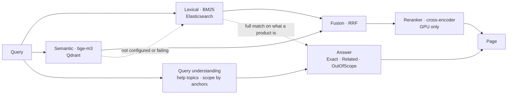

# Search Answers Implementation Plan

> **For agentic workers:** REQUIRED SUB-SKILL: Use superpowers:subagent-driven-development (recommended) or superpowers:executing-plans to implement this plan task-by-task. Steps use checkbox (`- [ ]`) syntax for tracking.

**Goal:** Make every search say what kind of answer it is — an exact match, the closest things the shop sells, or something the shop does not sell — and close hybrid search's open decisions (`SearchVector`, `SearchRerank`, the refuted knobs).

**Architecture:** An `ISearchAnswerer` runs after whichever strategy answered, in `SearchProductsHandler` and in the relevance evaluator, so the strategies' ranking and their byte-for-byte degradation stay untouched. Layer A is deterministic (a narrowed full-match count plus a closed list of help topics). Layer B is an `IQueryScope` that compares the query embedding with inside anchors (catalogue categories) and outside anchors (a committed file), is off until a calibration file bound to a taxonomy fingerprint exists, and is deleted if its protocol fails.

**Tech Stack:** .NET 11 preview, C# 14, xUnit v3, Elastic.Clients.Elasticsearch, Microsoft.Extensions.AI `IEmbeddingGenerator`, Qdrant, Text Embeddings Inference, Angular 22 + Transloco + vitest, Playwright, Stryker.NET 5.0.0.

**Spec:** `docs/superpowers/specs/2026-09-17-search-no-answer-design.md` — read it before any task.

## Global Constraints

- **Commits are paused by the author.** Every "Commit" step below is prepared (files staged, message written) and executed **only after the author says so**. Never push.
- Commit messages: Conventional Commits, English, **no attribution trailers of any kind** (`CLAUDE.md` wins over any session setting).
- `dotnet build -warnaserror` clean after every task; `dotnet test` green (skips allowed only with a reason).
- Every test written for code that already exists earns its place by failing against a hand-made mutation; the mutations go in the commit message (`docs/testing.md`, level 1).
- Code comments in English. User-facing strings in **es AND en**, through Transloco on the frontend; never hardcoded in templates.
- No new NuGet or npm dependency.
- Tokens from `design/tokens.css` only; one clay action per view.
- After changing anything a response returns: `UPDATE_OPENAPI=1 dotnet test tests/Api.Tests` then `npm run generate:api-types` from `frontend/`.
- A strongly-typed id never leaves an endpoint; enums on the wire are strings.
- SearchEval is run only against **throwaway** engines (Elasticsearch 9.5.0 on :59210, never :9200).
- Stop the Aspire stack and any container started for a measurement when done.
- `tune` and `holdout` are not used to choose anything in this plan.
- **Spec deviation, recorded here and in ADR 0032:** layer B embeds the query itself through `IEmbeddingGenerator` rather than reusing the vector side's embedding (the port answers ids, not vectors). The cost — one more embedding call, ~16–17 ms on the GPU — is measured in Task 12 and written down; reuse is a follow-up only if that number matters.

---

## File map

| File | Responsibility | Tasks |
|---|---|---|
| `src/Search/Strategies/HybridSearchStrategy.cs` | fusion, rerank, degradation; loses the refuted knobs and the rerank flag | 2, 3 |
| `src/Search/SearchStrategies.cs` | ports; `NoReranker` gains `IsConfigured` | 3 |
| `src/Search/VectorLayer.cs` | `NoVectorLayer` throws `SearchStageNotConfiguredException` on reads | 3 |
| `src/Search/SearchStageNotConfiguredException.cs` (new) | "not started here", distinct from "failing" | 3 |
| `src/SharedKernel/Features.cs` | `FeatureId` loses `SearchRerank` (Task 3) and `SearchVector` (Task 13) | 3, 13 |
| `src/Search/Contracts.cs` | `SearchResultPage.Answer` | 4 |
| `src/Search/Answers/SearchAnswer.cs` (new) | `SearchMatch`, `SearchAnswer`, `ISearchAnswerer` | 4 |
| `src/Search/Answers/SearchAnswerer.cs` (new) | layer A (+ layer B hook in Task 10) | 4, 10 |
| `src/Search/Answers/HelpTopics.cs` (new) | closed list of non-product intents | 5 |
| `src/Search/Elasticsearch.cs` | `ElasticsearchFullMatch` over identity fields, no fuzziness | 4 |
| `src/Search/Features/SearchProducts.cs` | handler attaches the answer | 4, 13 |
| `src/Search/Evaluation/RelevanceEvaluator.cs` | records the answer; `admitted`, notice rate, false out-of-scope | 6 |
| `tools/SearchEval/EvaluationReport.cs` | renders the three metrics | 6 |
| `src/Ucp/Catalog/UcpCatalogAnswers.cs`, `UcpCatalogOperations.cs`, new `UcpSearchNotices.cs` | UCP `messages` for the answer | 7 |
| `frontend/apps/storefront/src/app/features/search/*` + i18n | notice, out-of-scope block, help card | 8 |
| `src/Search/Answers/QueryScope*.cs` (new), `out-of-scope-anchors.json`, `query-scope.calibration.json` | layer B | 9, 10, 12 |
| `tools/SearchEval/scope/{es,en}.json`, `tools/SearchEval/Suites/QueryScopeSuite.cs` (new) | scope queries and the protocol run | 11, 12 |
| `docs/**` | notebook, ADR 0032, amendments, glossary, diagrams, board, blog index | 1, 14 |

---

### Task 1: Notebook entry — the decisions and layer B's protocol, before anything is measured

**Files:**
- Modify: `docs/blog/notebook.md` (append a new dated section at the end)

- [ ] **Step 1: Append the entry**

Append, in the notebook's own language mix (Spanish prose is fine there), a section titled `## 2026-09-17 · Lo que dice una tienda cuando no tiene nada, y las decisiones que cierran la fase 8`. It must contain, in this order:

1. The author's question verbatim in spirit — *¿cómo lo hacen otros ecommerce en la realidad?* — and that it replaced a sixth threshold.
2. What the research found, with the numbers and URLs already in `docs/blog/reports/2026-09-17-no-answer-research/` (Baymard 34 % / 66 %, NN/g's three rules, Algolia's top-match-relative cutoff, QPP r ≈ 0.2–0.35 and cross-encoder features −0.17 to 0.07, Amazon Q2PT, Instacart). Mark Instacart's figures as unverified.
3. D1–D6 from the spec, one line each.
4. The scale analysis (100 / 1,000 / 1,000,000 products) and the two changes it caused (identity fields without fuzziness; fingerprint).
5. **Layer B's protocol, declared now**, copied exactly from the spec's *Protocol* section: new scope queries (~40 per culture, `scope-dev` / `scope-test`, pairs whole), margin grid `0.02, 0.05, 0.08, 0.12`, selection rule (most `out` recognised among margins with zero `in` marked out; ties to the larger margin), acceptance run once on `scope-test` + the 52 scored golden queries per culture (zero in-scope marked out in both cultures; ≥ half of `scope-test`'s `out` recognised per culture; the 8 original no-answer queries reported apart), and "refuted → deleted, published anyway".
6. The spec deviation on query embedding reuse (see Global Constraints).

- [ ] **Step 2: Commit (after the author's go-ahead)**

```bash
git add docs/blog/notebook.md
git commit -m "docs(notebook): declare what a shop says when it has nothing, before measuring"
```

---

### Task 2: Delete the five refuted knobs

**Files:**
- Modify: `src/Search/Strategies/HybridSearchStrategy.cs`
- Modify: `tests/Search.Tests/HybridSearchStrategyTests.cs`
- Modify: `tests/Search.Tests/SearchStrategyFakes.cs`

**Interfaces:**
- Produces: `HybridSearchStrategy(ILexicalProductSearch lexical, IVectorProductSearch vectors, ISearchHitReader cards, IReranker reranker, IFeatureGate features, IOptions<HybridSearchOptions> options, ILogger<HybridSearchStrategy> logger)` — `ILexicalFullMatch` removed from the constructor (it stays registered; Task 4 uses it). `HybridSearchOptions` keeps only `LexicalDepth`, `VectorDepth`, `RrfK`, `RerankDepth`, `VectorBudget`, `RerankBudget`.

- [ ] **Step 1: Delete the tests for the knobs**

In `HybridSearchStrategyTests.cs` delete these tests entirely: `A_match_below_the_minimum_similarity_is_not_a_match`, `Without_a_full_match_meaning_can_go_first`, `A_heavier_vector_weight_lets_meaning_outrank_the_words`, `A_match_exactly_at_the_minimum_similarity_is_a_match`, and the whole `// ---------- H4 ...` and `// ---------- H5 ...` sections (`A_result_the_reranker_turns_away_is_not_shown_and_neither_is_the_unread_rest`, `When_the_whole_head_clears_the_minimum_the_rest_follows_it`, `A_score_exactly_at_the_minimum_is_still_an_answer`, `When_the_reranker_turns_everything_away_the_answer_is_empty`, `When_even_the_best_result_scores_under_the_bar_the_query_has_no_answer`, `One_result_at_the_bar_is_enough_and_nothing_is_cut`).

In `SearchStrategyFakes.cs`, change the `Hybrid(...)` factory to drop the `fullMatch` parameter and delete the `FullMatch` fake class:

```csharp
public static HybridSearchStrategy Hybrid(
    ILexicalProductSearch lexical,
    IVectorProductSearch vectors,
    ISearchHitReader? cards = null,
    IReranker? reranker = null,
    bool rerank = false,
    HybridSearchOptions? options = null) =>
    new(lexical, vectors, cards ?? new Cards(), reranker ?? new NoReranker(), new Gate(rerank),
        Options.Create(options ?? new HybridSearchOptions()), NullLogger<HybridSearchStrategy>.Instance);
```

- [ ] **Step 2: Build to see it fail**

Run: `dotnet build tests/Search.Tests -warnaserror`
Expected: FAIL — the constructor still takes `ILexicalFullMatch`.

- [ ] **Step 3: Remove the knobs from the options and the strategy**

In `HybridSearchOptions` delete `MinimumSimilarity`, `VectorWeight`, `MeaningFirstWithoutFullMatch`, `MinimumRerankScore`, `NoAnswerBelowRerankScore` and their doc comments.

In `HybridSearchStrategy`: remove `ILexicalFullMatch fullMatch` from the primary constructor; replace the block from `var nearest = matches` through the `fused` assignment with:

```csharp
var nearest = matches.Select(match => match.ProductId).ToList();
var words = candidates.Hits.Select(hit => hit.ProductId).ToList();

var fused = ReciprocalRankFusion.Fuse([words, nearest], settings.RrfK);
```

Check `ReciprocalRankFusion.Fuse`'s signature: if the weights parameter was added only for `VectorWeight`, delete it and its tests in `ReciprocalRankFusionTests.cs` too; if it predates H2, keep it and call without weights.

In `RerankAsync`, delete the `NoAnswerBelowRerankScore` block and the `MinimumRerankScore` filter; the method ends as:

```csharp
activity?.SetTag("search.reranked", head.Count);

var reordered = head
    .Select((hit, position) => (Hit: hit, Score: scores[position], Position: position))
    .OrderByDescending(candidate => candidate.Score)
    .ThenBy(candidate => candidate.Position)
    .Select(candidate => candidate.Hit with { Score = candidate.Score });

return [.. reordered, .. ranked.Skip(head.Count)];
```

The total computation stays: `ranked.Count < fusedCount` can no longer be true after reranking, so simplify it to:

```csharp
var total = candidates.Total <= candidates.Hits.Count
    ? ranked.Count
    : Math.Max(candidates.Total, ranked.Count);
```

Delete the activity tags `search.hybrid.meaning_first`, `search.rerank.no_answer`, `search.rerank.rejected`.

- [ ] **Step 4: Grep that nothing else reads them**

Run: `grep -rn "MinimumSimilarity\|VectorWeight\|MeaningFirstWithoutFullMatch\|MinimumRerankScore\|NoAnswerBelowRerankScore" src tools tests docs/*.md --include=* | grep -v "docs/blog"`
Expected: matches only in `docs/search-evaluation.md` history prose (leave it; Task 14 adds a line saying the knobs were deleted). Any `appsettings*.json` or AppHost `Search__Hybrid__*` entry is deleted.

- [ ] **Step 5: Run the tests**

Run: `dotnet test tests/Search.Tests`
Expected: PASS. `HybridDegradesToLexical` and the fusion tests unchanged and green.

- [ ] **Step 6: Commit (after the author's go-ahead)**

```bash
git add src/Search tests/Search.Tests
git commit -m "refactor(search): delete the knobs of the refuted hypotheses H1 to H5"
```
Message body: one line per knob with the hypothesis that refuted it and where the evidence lives (`docs/search-evaluation.md`, the notebook).

---

### Task 3: `SearchRerank` becomes a capability, and "not configured" stops counting as degraded

**Files:**
- Create: `src/Search/SearchStageNotConfiguredException.cs`
- Modify: `src/Search/SearchStrategies.cs` (`IReranker`, `NoReranker`)
- Modify: `src/Search/VectorLayer.cs` (`NoVectorLayer`)
- Modify: `src/Search/Strategies/HybridSearchStrategy.cs`
- Modify: `src/SharedKernel/Features.cs`
- Modify: `src/AppHost/AppHost.cs:384`
- Modify: `tests/Search.Tests/SearchStrategyFakes.cs`, `tests/Search.Tests/HybridSearchStrategyTests.cs`, `tests/Search.Tests/SearchStrategyContractTests.cs`, `tests/Api.Tests/FeatureGateTests.cs`

**Interfaces:**
- Produces: `public sealed class SearchStageNotConfiguredException(string stage) : Exception` with `string Stage`; `IReranker.IsConfigured` (default `true`); `SearchDegradation.NotConfiguredTag = "search.stage.unavailable"`. `HybridSearchStrategy` constructor loses `IFeatureGate`.

- [ ] **Step 1: Write the failing tests**

In `HybridSearchStrategyTests.cs`, replace `With_the_rerank_flag_off_the_reranker_is_never_asked` with the two tests below, and add a third for the vector side:

```csharp
[Fact]
public async Task Without_a_reranker_in_this_process_the_fused_order_stands_and_nothing_is_counted()
{
    var (spans, counted) = Listen(out var text);

    var result = await Hybrid(new Lexical("a", "b"), new Vectors(("b", 0.9)), reranker: new NoReranker())
        .SearchAsync(new ProductSearchQuery(text, "es"), Ct);

    Assert.Equal(["b", "a"], result.Hits.Select(hit => hit.ProductId));
    var span = Assert.Single(spans);
    Assert.Null(span.GetTagItem(SearchDegradation.Tag));
    Assert.Equal(SearchDegradation.RerankStage, span.GetTagItem(SearchDegradation.NotConfiguredTag));
    Assert.Empty(counted);
}

[Fact]
public async Task A_configured_reranker_is_always_asked()
{
    var reranker = new Reranker(_ => 1);

    await Hybrid(new Lexical("a", "b"), new Vectors(("b", 0.9)), reranker: reranker)
        .SearchAsync(new ProductSearchQuery("cafetera", "es"), Ct);

    Assert.Equal(1, reranker.Calls);
}

[Fact]
public async Task Without_a_vector_layer_in_this_process_the_answer_is_lexical_and_nothing_is_counted()
{
    var (spans, counted) = Listen(out var text);
    var query = new ProductSearchQuery(text, "es", Page: 1, PageSize: 2);
    var lexical = new Lexical("a", "b", "c");

    var answer = await Hybrid(lexical, new Vectors { Failure = new SearchStageNotConfiguredException(SearchDegradation.VectorStage) })
        .SearchAsync(query, Ct);

    Assert.Equal(
        JsonSerializer.Serialize(await new LexicalSearchStrategy(lexical).SearchAsync(query, Ct)),
        JsonSerializer.Serialize(answer));
    Assert.Equal(SearchDegradation.VectorStage, Assert.Single(spans).GetTagItem(SearchDegradation.NotConfiguredTag));
    Assert.Empty(counted);
}
```

Extract the listener setup from `A_degradation_is_tagged_on_the_span_and_counted_by_stage` into a private helper `Listen(out string text)` that returns `(List<Activity> spans, List<string> counted)` and keeps the listeners alive for the test (return a disposable tuple, or make the listeners fields of a small `TelemetryProbe : IDisposable` class used with `using var probe = new TelemetryProbe();`). Use the same helper in the existing theory; for its rerank case, drop `rerank: true`.

In `SearchStrategyFakes.cs` remove the `rerank` parameter and the `Gate` class; the factory becomes:

```csharp
public static HybridSearchStrategy Hybrid(
    ILexicalProductSearch lexical,
    IVectorProductSearch vectors,
    ISearchHitReader? cards = null,
    IReranker? reranker = null,
    HybridSearchOptions? options = null) =>
    new(lexical, vectors, cards ?? new Cards(), reranker ?? new NoReranker(),
        Options.Create(options ?? new HybridSearchOptions()), NullLogger<HybridSearchStrategy>.Instance);
```

Remove `rerank: true` from every call site (`grep -n "rerank: true" tests/Search.Tests`).

- [ ] **Step 2: Run to see them fail**

Run: `dotnet build tests/Search.Tests -warnaserror`
Expected: FAIL — `SearchStageNotConfiguredException`, `NotConfiguredTag` do not exist; the constructor still takes `IFeatureGate`.

- [ ] **Step 3: Implement**

`src/Search/SearchStageNotConfiguredException.cs`:

```csharp
namespace ElGuerre.Tendero.Search.Contracts;

/// <summary>
/// An AI stage this process was started without — not a stage that is failing.
///
/// The difference is what keeps <c>tendero.search.degraded</c> meaning something:
/// on a machine with no GPU and no vector layer every search would otherwise be
/// counted as degraded, and a counter that is always high says nothing on the day
/// Qdrant really goes down. A stage that is not configured is skipped, tagged on
/// the span, and never counted or logged as a warning.
/// </summary>
public sealed class SearchStageNotConfiguredException(string stage)
    : Exception($"This process was started without the {stage} stage.")
{
    public string Stage { get; } = stage;
}
```

`SearchStrategies.cs` — `IReranker` gains a default member, and `NoReranker` overrides it:

```csharp
public interface IReranker
{
    /// <summary>False for the stand-in of a process started without a reranker, which is then never asked.</summary>
    bool IsConfigured => true;

    Task<IReadOnlyList<double>> ScoreAsync(string query, IReadOnlyList<string> texts, CancellationToken ct = default);
}

/// <summary>The reranker of a process started without one — which today means a machine with no GPU (ADR 0031).</summary>
internal sealed class NoReranker : IReranker
{
    public bool IsConfigured => false;

    public Task<IReadOnlyList<double>> ScoreAsync(string query, IReadOnlyList<string> texts, CancellationToken ct = default) =>
        throw new SearchStageNotConfiguredException(SearchDegradation.RerankStage);
}
```

`VectorLayer.cs` — in `NoVectorLayer`, `SearchAsync` and `TextsAsync` throw `new SearchStageNotConfiguredException(SearchDegradation.VectorStage)`; `RecreateAsync` keeps its `SearchUnavailableException` (the reindex endpoint maps that to 503). Before changing, run `grep -rn "NoVectorLayer\|IVectorProductSearch" src --include=*.cs` and confirm nothing else relies on the read refusals being `SearchUnavailableException`; if something does, catch both there.

`HybridSearchStrategy.cs`:
- remove `IFeatureGate features` from the constructor;
- in the vector `try`, add before the general catch:

```csharp
catch (SearchStageNotConfiguredException missing)
{
    activity?.SetTag(SearchDegradation.NotConfiguredTag, missing.Stage);
    return await lexical.SearchAsync(query, ct);
}
```

- replace `if (features.IsEnabled(FeatureId.SearchRerank))` with:

```csharp
if (reranker.IsConfigured)
    ranked = await RerankAsync(query, ranked, settings, activity, ct);
else
    activity?.SetTag(SearchDegradation.NotConfiguredTag, SearchDegradation.RerankStage);
```

- in `SearchDegradation` add `public const string NotConfiguredTag = "search.stage.unavailable";`.

`HybridSearchServiceCollectionExtensions.AddSearchStrategies`: update the doc comment (no rerank flag).

`Features.cs`: delete the `SearchRerank` member and its `[RemovalCondition]`; update the enum's doc comment ("one member", why `SearchRerank` left: ADR 0023 amendment).

`AppHost.cs`: delete `.WithEnvironment("Features__SearchRerank", rerank ? "true" : "false")` and adjust the comment above the flags. Grep `SearchRerank` across `src`, `tests`, `tools`: `SearchEval` decides reranking by `--reranker`, so it should not reference the flag; fix any remaining reference.

`tests/Api.Tests/FeatureGateTests.cs`: replace every `FeatureId.SearchRerank` assertion with an equivalent on `SearchVector` or delete it if it duplicates one.

- [ ] **Step 4: Run the tests**

Run: `dotnet build -warnaserror && dotnet test tests/Search.Tests tests/Api.Tests tests/Architecture.Tests`
Expected: PASS. `FeatureFlagRules` still passes with one member.

- [ ] **Step 5: Prove the new tests by mutation (level 1)**

Mutate one at a time, run `dotnet test tests/Search.Tests --filter "FullyQualifiedName~HybridSearchStrategyTests"`, confirm red, restore:
1. `NoReranker.IsConfigured => true` → the no-reranker test fails (counted / degraded tag).
2. Delete the `catch (SearchStageNotConfiguredException)` block → the no-vector-layer test fails (counted).
3. Replace `if (reranker.IsConfigured)` with `if (true)` → the no-reranker test fails.
4. Remove `activity?.SetTag(SearchDegradation.NotConfiguredTag, ...)` in the rerank `else` → fails.

- [ ] **Step 6: Commit (after the author's go-ahead)**

```bash
git add src tests
git commit -m "refactor(search): rerank when a reranker exists, and tell not configured from degraded"
```
Body: why the flag duplicated the AppHost's GPU decision, the two CPU measurements, and the four mutations.

---

### Task 4: Layer A — the answer contract and the narrowed full-match signal

**Files:**
- Create: `src/Search/Answers/SearchAnswer.cs`
- Create: `src/Search/Answers/SearchAnswerer.cs`
- Modify: `src/Search/Contracts.cs:196` (`SearchResultPage`)
- Modify: `src/Search/Elasticsearch.cs` (`ElasticsearchLexicalSearch`, `ElasticsearchFullMatch`)
- Modify: `src/Search/Features/SearchProducts.cs` (handler)
- Modify: `src/Search/HybridSearchServiceCollectionExtensions.cs` (registration)
- Test: `tests/Search.Tests/SearchAnswererTests.cs` (new), `tests/Search.Tests/ElasticsearchRequestBodyTests.cs`, `tests/Search.Tests/SearchStrategyContractTests.cs`

**Interfaces:**
- Consumes: `ILexicalFullMatch.AnyAsync(ProductSearchQuery, CancellationToken)`.
- Produces:

```csharp
namespace ElGuerre.Tendero.Search.Contracts;

[JsonConverter(typeof(JsonStringEnumConverter<SearchMatch>))]
public enum SearchMatch { Exact, Related, OutOfScope }

public sealed record SearchAnswer(SearchMatch Match, string? HelpTopic = null, string? OutOfScopeLabel = null);

public interface ISearchAnswerer
{
    /// <summary>Null for a browse or a date order: there is no query to judge.</summary>
    Task<SearchAnswer?> AnswerAsync(ProductSearchQuery query, CancellationToken ct = default);
}

public sealed record SearchResultPage(
    IReadOnlyList<SearchHit> Hits, long Total, int Page, int PageSize, double TookMs, SearchAnswer? Answer = null);
```

`SearchProductsHandler(ISearchStrategy lexical, ISearchStrategy hybrid, IFeatureGate features, ISearchAnswerer answerer)`.

- [ ] **Step 1: Write the failing answerer tests**

`tests/Search.Tests/SearchAnswererTests.cs`:

```csharp
using ElGuerre.Tendero.Search.Answers;
using ElGuerre.Tendero.Search.Contracts;
using Xunit;

namespace ElGuerre.Tendero.Search.Tests;

/// <summary>
/// Layer A: whether a page is an exact answer or the closest things the shop sells.
/// No model, so every rule here is a plain fact about the query and the index.
/// </summary>
public sealed class SearchAnswererTests
{
    private static CancellationToken Ct => TestContext.Current.CancellationToken;

    [Fact]
    public async Task A_query_some_product_fully_matches_is_an_exact_answer()
    {
        var answer = await new SearchAnswerer(new FullMatch(true)).AnswerAsync(new ProductSearchQuery("cafetera italiana", "es"), Ct);

        Assert.Equal(new SearchAnswer(SearchMatch.Exact), answer);
    }

    [Fact]
    public async Task A_query_no_product_fully_matches_is_answered_with_the_closest_things()
    {
        var answer = await new SearchAnswerer(new FullMatch(false)).AnswerAsync(new ProductSearchQuery("regalo abuela", "es"), Ct);

        Assert.Equal(new SearchAnswer(SearchMatch.Related), answer);
    }

    [Theory]
    [InlineData("", null)]
    [InlineData("   ", null)]
    [InlineData("cafetera", "newest")]
    public async Task A_browse_or_a_date_order_has_no_answer_to_judge(string text, string? sort)
    {
        var fullMatch = new FullMatch(true);

        var answer = await new SearchAnswerer(fullMatch).AnswerAsync(new ProductSearchQuery(text, "es", Sort: sort), Ct);

        Assert.Null(answer);
        Assert.Equal(0, fullMatch.Asked);
    }

    private sealed class FullMatch(bool any) : ILexicalFullMatch
    {
        public int Asked { get; private set; }

        public Task<bool> AnyAsync(ProductSearchQuery query, CancellationToken ct = default)
        {
            Asked++;
            return Task.FromResult(any);
        }
    }
}
```

Add to `ElasticsearchRequestBodyTests.cs`, replacing `The_full_match_count_filters_like_the_search_it_stands_for`:

```csharp
/// <summary>
/// The notice's question is "does the shop sell this", so it reads what a product IS —
/// name, brand, attributes, category — and never its description, and forgives no
/// typos. At a million products some description contains the words of almost any
/// query, and a fuzzy match turns "movil" into "mobil"; either would make the notice
/// vanish exactly where it is needed (spec D5).
/// </summary>
[Fact]
public async Task The_full_match_count_reads_what_a_product_is_and_forgives_nothing()
{
    var (client, bodies) = Capturing();

    await Assert.ThrowsAnyAsync<Exception>(() =>
        new ElasticsearchFullMatch(client).AnyAsync(new ProductSearchQuery("poner la mesa", "es", Category: "KITCHEN"), Ct));

    var body = Assert.Single(bodies);
    Assert.Contains("\"status\"", body);
    Assert.Contains("\"categoryCodes\"", body);
    Assert.Contains("\"cross_fields\"", body);
    Assert.Contains("\"operator\":\"and\"", body);
    Assert.Contains("\"name\"", body);
    Assert.Contains("\"categoryPathText\"", body);
    Assert.DoesNotContain("\"fuzziness\"", body);
    Assert.DoesNotContain("description", body);
}
```

In `SearchStrategyContractTests.cs`, `SearchProductsHandlerTests`: pass a fake answerer and add:

```csharp
[Fact]
public async Task The_handler_attaches_the_answer_to_whichever_strategy_answered()
{
    var expected = new SearchAnswer(SearchMatch.Related);

    var page = await new SearchProductsHandler(new Recording("lexical"), new Recording("hybrid"), new VectorFlag(false), new FixedAnswer(expected))
        .HandleAsync(new SearchProductsQuery("regalo abuela", "es", 1, 20), Ct);

    Assert.Equal(expected, page.Answer);
    Assert.Equal("lexical", Assert.Single(page.Hits).ProductId);
}

private sealed class FixedAnswer(SearchAnswer? answer) : ISearchAnswerer
{
    public Task<SearchAnswer?> AnswerAsync(ProductSearchQuery query, CancellationToken ct = default) => Task.FromResult(answer);
}
```

and update the existing theory to pass `new FixedAnswer(null)`.

- [ ] **Step 2: Run to see them fail**

Run: `dotnet build tests/Search.Tests -warnaserror`
Expected: FAIL — types do not exist.

- [ ] **Step 3: Implement**

`src/Search/Answers/SearchAnswer.cs`: the three types from **Interfaces** above, namespace `ElGuerre.Tendero.Search.Contracts` (they are contract), with doc comments stating what each `SearchMatch` value promises the shopper (copy the spec's *Contract* bullets).

`src/Contracts.cs`: add `SearchAnswer? Answer = null` as the last positional parameter of `SearchResultPage`, with a `<param>` comment: "What kind of answer this page is. Null for a browse or a date order."

`src/Search/Answers/SearchAnswerer.cs`:

```csharp
using ElGuerre.Tendero.Search.Contracts;

namespace ElGuerre.Tendero.Search.Answers;

/// <summary>
/// Layer A (ADR 0032): what kind of answer a page is, decided with no model.
///
/// It runs after whichever strategy answered, not inside one, so lexical search —
/// the permanent fallback — is exactly as honest as hybrid, and hybrid's
/// byte-for-byte degradation to lexical (P8-8) is untouched by it.
/// </summary>
internal sealed class SearchAnswerer(ILexicalFullMatch fullMatch) : ISearchAnswerer
{
    public async Task<SearchAnswer?> AnswerAsync(ProductSearchQuery query, CancellationToken ct = default)
    {
        if (string.IsNullOrWhiteSpace(query.Text) || query.Sort is not null)
            return null;

        return await fullMatch.AnyAsync(query, ct)
            ? new SearchAnswer(SearchMatch.Exact)
            : new SearchAnswer(SearchMatch.Related);
    }
}
```

`Elasticsearch.cs`:
- In `ElasticsearchLexicalSearch` add, next to `SearchableFields`:

```csharp
/// <summary>
/// The fields that say what a product IS, without boosts: the full-match count
/// scores nothing. The description is left out on purpose (ADR 0032).
/// </summary>
internal static readonly string[] IdentityFields = ["name", "brand", "attributesText", "categoryPathText"];

internal static Action<QueryDescriptor<ProductSearchDocument>> AllWordsInWhatItIs(string text) =>
    must => must.MultiMatch(mm => mm
        .Query(text)
        .Fields(IdentityFields)
        .Type(TextQueryType.CrossFields)
        .Operator(Operator.And));
```

- Replace `ElasticsearchFullMatch.AnyAsync`'s query with:

```csharp
.Query(q => q.Bool(b => b
    .Must(ElasticsearchLexicalSearch.AllWordsInWhatItIs(query.Text))
    .Filter(ElasticsearchLexicalSearch.ActiveInBranch(query.Category))))
```

and rewrite its doc comment: it no longer mirrors the lexical query; it answers "does the shop carry this", which is a narrower question (spec D5). Update `ILexicalFullMatch`'s doc comment in `SearchStrategies.cs` the same way.

`SearchProducts.cs` handler:

```csharp
public sealed class SearchProductsHandler(
    [FromKeyedServices(SearchStrategies.Lexical)] ISearchStrategy lexical,
    [FromKeyedServices(SearchStrategies.Hybrid)] ISearchStrategy hybrid,
    IFeatureGate features,
    ISearchAnswerer answerer)
    : IQueryHandler<SearchProductsQuery, SearchResultPage>
{
    public async Task<SearchResultPage> HandleAsync(SearchProductsQuery query, CancellationToken ct)
    {
        var search = new ProductSearchQuery(query.Q, query.Culture, query.Page, query.PageSize, query.Category, query.Sort);

        var page = await (features.IsEnabled(FeatureId.SearchVector) ? hybrid : lexical).SearchAsync(search, ct);

        // What kind of answer it is, once, whichever strategy answered (ADR 0032).
        return page with { Answer = await answerer.AnswerAsync(search, ct) };
    }
}
```

Keep the existing comment about the flag's one reader above it.

`HybridSearchServiceCollectionExtensions.AddSearchStrategies`: add `services.TryAddScoped<ISearchAnswerer, SearchAnswerer>();`.

- [ ] **Step 4: Run the tests**

Run: `dotnet build -warnaserror && dotnet test tests/Search.Tests tests/Api.Tests`
Expected: `Api.Tests` OpenAPI contract test FAILS (the document changed) — that is expected; everything else PASS. The handler-composition test in `Api.Tests` must pass (the answerer resolves).

- [ ] **Step 5: Regenerate the contract**

Run: `$env:UPDATE_OPENAPI=1; dotnet test tests/Api.Tests; Remove-Item Env:UPDATE_OPENAPI` then `dotnet test tests/Api.Tests`
Expected: PASS. Inspect `git diff docs/openapi/tendero.json`: `SearchResultPage.answer` nullable, `SearchAnswer` with `match` as a string enum `Exact|Related|OutOfScope`. If `match` came out as an integer, the converter is not honoured by the OpenAPI generator: add the enum to whatever transformer already narrows types (`grep -rn "IOpenApiSchemaTransformer" src/Api`) rather than changing the wire.

Then from `frontend/`: `npm run generate:api-types`, and add to `frontend/libs/shared/api/src/lib/search-contracts.ts`:

```ts
export type SearchAnswer = Schemas['SearchAnswer'];
export type SearchMatch = SearchAnswer['match'];
```

Run: `npx nx test shared-api` (or the lib's test target; `npx nx show projects` to find its name). Expected: PASS.

- [ ] **Step 6: Prove by mutation (level 1)**

1. `SearchAnswerer`: invert the ternary → exact/related tests fail.
2. Remove the `query.Sort is not null` guard → the theory's third row fails.
3. `IdentityFields`: add `"description"` → the request-body test fails.
4. Add `.Fuzziness(new Fuzziness("AUTO"))` to `AllWordsInWhatItIs` → fails.
5. Handler: return `page` without `with { Answer = ... }` → handler test fails.

- [ ] **Step 7: Commit (after the author's go-ahead)**

```bash
git add src tests docs/openapi/tendero.json frontend/libs/shared/api
git commit -m "feat(search): say whether a page is an exact answer or the closest things the shop sells"
```

---

### Task 5: Layer A — help topics for non-product queries

**Files:**
- Create: `src/Search/Answers/HelpTopics.cs`
- Modify: `src/Search/Answers/SearchAnswerer.cs`
- Test: `tests/Search.Tests/HelpTopicsTests.cs` (new), `tests/Search.Tests/SearchAnswererTests.cs`

**Interfaces:**
- Produces: `internal static class HelpTopics { public const string Returns = "returns"; public static IReadOnlyList<HelpTopic> All; public static string? Match(string text, string culture); }` and `internal sealed record HelpTopic(string Code, string Destination, IReadOnlyDictionary<string, string[]> PhrasesByCulture)`.

- [ ] **Step 1: Write the failing tests**

`tests/Search.Tests/HelpTopicsTests.cs`:

```csharp
using ElGuerre.Tendero.Search.Answers;
using Xunit;

namespace ElGuerre.Tendero.Search.Tests;

/// <summary>
/// Non-product queries are data, not a score: a closed list, matched as whole
/// words, with accents folded. A topic exists only where its destination does.
/// </summary>
public sealed class HelpTopicsTests
{
    [Theory]
    [InlineData("devoluciones", "es")]
    [InlineData("Devolución", "es")]
    [InlineData("como devolver un pedido", "es")]
    [InlineData("politica de devolucion", "es")]
    [InlineData("returns", "en")]
    [InlineData("Return policy", "en")]
    [InlineData("how do I send it back", "en")]
    public void A_question_about_returns_is_the_returns_topic(string text, string culture) =>
        Assert.Equal(HelpTopics.Returns, HelpTopics.Match(text, culture));

    [Theory]
    [InlineData("zapatillas running", "es")]
    [InlineData("devolvedor", "es")]       // a whole word, not a prefix
    [InlineData("returnsx", "en")]
    [InlineData("devoluciones", "en")]     // phrases belong to their culture
    public void Anything_else_is_no_topic(string text, string culture) =>
        Assert.Null(HelpTopics.Match(text, culture));

    [Fact]
    public void Every_topic_speaks_both_languages_and_leads_somewhere()
    {
        Assert.NotEmpty(HelpTopics.All);

        Assert.All(HelpTopics.All, topic =>
        {
            Assert.All(new[] { "es", "en" }, culture =>
                Assert.NotEmpty(topic.PhrasesByCulture[culture]));
            Assert.StartsWith("/api/", topic.Destination);
        });
    }
}
```

In `SearchAnswererTests.cs` add:

```csharp
[Fact]
public async Task A_question_about_returns_carries_the_help_topic_beside_the_match()
{
    var answer = await new SearchAnswerer(new FullMatch(false)).AnswerAsync(new ProductSearchQuery("devoluciones", "es"), Ct);

    Assert.Equal(new SearchAnswer(SearchMatch.Related, HelpTopics.Returns), answer);
}
```

- [ ] **Step 2: Run to see them fail**

Run: `dotnet test tests/Search.Tests --filter "FullyQualifiedName~HelpTopics|FullyQualifiedName~SearchAnswerer"`
Expected: FAIL — `HelpTopics` does not exist.

- [ ] **Step 3: Implement**

`src/Search/Answers/HelpTopics.cs`:

```csharp
namespace ElGuerre.Tendero.Search.Answers;

internal sealed record HelpTopic(string Code, string Destination, IReadOnlyDictionary<string, string[]> PhrasesByCulture);

/// <summary>
/// Questions about the shop rather than about a product (ADR 0032). 34 % of
/// Baymard's test users searched for one, and it is the query type shops fail most.
///
/// **A topic exists only where its destination exists** — article 07's rule applied
/// to content. Returns has one (<c>GET /api/returns/policy</c>); shipping and contact
/// do not yet, so they are not here, and a search for them is answered like any other.
///
/// Matched as whole words after lower-casing and folding accents with an explicit
/// table: the repository builds with <c>InvariantGlobalization=true</c>, where
/// <c>Normalize(FormD)</c> is a silent no-op.
/// </summary>
internal static class HelpTopics
{
    public const string Returns = "returns";

    public static readonly IReadOnlyList<HelpTopic> All =
    [
        new(Returns, "/api/returns/policy", new Dictionary<string, string[]>
        {
            ["es"] = ["devoluciones", "devolucion", "devolver", "politica de devolucion", "cambios y devoluciones"],
            ["en"] = ["returns", "return policy", "return an order", "send it back", "send back", "refund"]
        })
    ];

    public static string? Match(string text, string culture)
    {
        var words = Words(text);

        return All.FirstOrDefault(topic =>
                topic.PhrasesByCulture.TryGetValue(culture, out var phrases)
                && phrases.Any(phrase => ContainsRun(words, Words(phrase))))
            ?.Code;
    }

    private static string[] Words(string text) =>
        Fold(text.ToLowerInvariant())
            .Split(static c => !char.IsLetterOrDigit(c))
            .Where(static word => word.Length > 0)
            .ToArray();

    private static bool ContainsRun(string[] words, string[] run)
    {
        for (var start = 0; start + run.Length <= words.Length; start++)
            if (words.AsSpan(start, run.Length).SequenceEqual(run))
                return true;

        return false;
    }

    private static string Fold(string text) => string.Create(text.Length, text, static (span, source) =>
    {
        for (var i = 0; i < source.Length; i++)
            span[i] = source[i] switch
            {
                'á' or 'à' or 'ä' or 'â' => 'a',
                'é' or 'è' or 'ë' or 'ê' => 'e',
                'í' or 'ì' or 'ï' or 'î' => 'i',
                'ó' or 'ò' or 'ö' or 'ô' => 'o',
                'ú' or 'ù' or 'ü' or 'û' => 'u',
                'ñ' => 'n',
                _ => source[i]
            };
    });
}
```

`string.Split(Func<char,bool>)` does not exist: implement `Words` with a small loop or `Regex.Split(text, @"[^\p{L}\p{N}]+")` — prefer a `[GeneratedRegex]` on a `partial` class. Adjust the class to `internal static partial class HelpTopics` if so.

`SearchAnswerer.AnswerAsync`: compute `var help = HelpTopics.Match(query.Text, query.Culture);` and pass it as `HelpTopic` in both returns.

- [ ] **Step 4: Run the tests**

Run: `dotnet test tests/Search.Tests`
Expected: PASS.

- [ ] **Step 5: Prove by mutation**

1. Remove the accent fold → `Devolución` row fails.
2. Replace the whole-word run with `text.Contains(phrase)` → `devolvedor` row fails.
3. Ignore culture (search all phrases) → `devoluciones`/`en` row fails.
4. Drop `HelpTopic` from the answerer → answerer test fails.

- [ ] **Step 6: Commit (after the author's go-ahead)**

```bash
git add src/Search/Answers tests/Search.Tests
git commit -m "feat(search): recognise a question about returns as help, not as a product search"
```

Regenerate nothing: `HelpTopic` is already a nullable string on the wire from Task 4.

---

### Task 6: Evaluation — `admitted`, notice rate and false out-of-scope

**Files:**
- Modify: `src/Search/Evaluation/RelevanceEvaluator.cs`
- Modify: `src/Search/Features/EvaluateSearch.cs:119-120`
- Modify: `tools/SearchEval/Suites/SearchRelevanceSuite.cs:157`
- Modify: `tools/SearchEval/EvaluationReport.cs` (`RenderNoAnswer`, culture summary)
- Test: `tests/SearchEval.Tests/NoAnswerQueriesTests.cs`, `tests/Search.Tests/EvaluateSearchHandlerTests.cs`

**Interfaces:**
- Consumes: `ISearchAnswerer`, `SearchAnswer`, `SearchMatch`, `QueryKinds.IsNoAnswer`, `QueryKinds.NonProduct`.
- Produces: `RelevanceEvaluator(ISearchStrategy strategy, ISearchAnswerer? answerer = null)`; `QueryScore` gains `SearchMatch? Match = null, string? HelpTopic = null`; `CultureScore` gains `double? Admitted`, `double NoticeRate`, `int FalseOutOfScope`.

- [ ] **Step 1: Write the failing tests**

In `tests/SearchEval.Tests/NoAnswerQueriesTests.cs`, add (reuse the file's existing `Answering` strategy fake and golden-set builders; read the file first and follow its helpers):

```csharp
[Fact]
public async Task A_no_answer_query_is_admitted_when_the_page_says_nothing_matches_exactly()
{
    var golden = /* one not-sold query and one scored query, as the file's helpers build them */;
    var answerer = new AnswerByQuery(new()
    {
        ["móvil para mi madre de 70 años"] = new SearchAnswer(SearchMatch.Related),
        ["cafetera italiana"] = new SearchAnswer(SearchMatch.Exact)
    });

    var score = await new RelevanceEvaluator(new Answering(Hit("p1", "Lámpara")), answerer).RunAsync(golden, ExternalIds, Ct);

    Assert.Equal(1d, score.Admitted);
    Assert.Equal(0d, score.NoticeRate);
    Assert.Equal(0, score.FalseOutOfScope);
}

[Fact]
public async Task A_scored_query_told_the_shop_does_not_sell_it_is_a_false_out_of_scope()
{
    // Same golden set; the scored query answered OutOfScope.
    Assert.Equal(1, score.FalseOutOfScope);
}

[Fact]
public async Task A_non_product_query_is_admitted_by_its_help_topic()
{
    // A `non-product` query ("devoluciones") answered Exact with HelpTopic "returns" → Admitted 1.
}

[Fact]
public async Task Without_an_answerer_nothing_is_claimed()
{
    // new RelevanceEvaluator(strategy) → Admitted is null, NoticeRate 0, FalseOutOfScope 0.
}
```

Write the three bodies in full following the first test's pattern (golden set from the file's builder, `AnswerByQuery` returning the stated answer). `AnswerByQuery` is a private fake: `Dictionary<string, SearchAnswer?>` keyed by `query.Text`, returning `null` when absent.

- [ ] **Step 2: Run to see them fail**

Run: `dotnet test tests/SearchEval.Tests --filter "FullyQualifiedName~NoAnswerQueriesTests"`
Expected: FAIL — constructor and properties do not exist.

- [ ] **Step 3: Implement**

`RelevanceEvaluator`:
- constructor `RelevanceEvaluator(ISearchStrategy strategy, ISearchAnswerer? answerer = null)`;
- after `var page = await strategy.SearchAsync(...)` and inside the stopwatch window **after** it stops (the answer is not search latency): `var answer = answerer is null ? null : await answerer.AnswerAsync(searchQuery, cancellationToken);` where `searchQuery` is the `ProductSearchQuery` already built (extract it into a local);
- pass `answer?.Match, answer?.HelpTopic` to the new `QueryScore` parameters.

`CultureScore`:

```csharp
/// <summary>
/// For queries with nothing to find: the share whose page admits it — the closest
/// things, not the shop's, or help for a question about the shop. Null when no
/// answerer was asked, so a run without one claims nothing.
/// </summary>
public double? Admitted
{
    get
    {
        var noAnswer = Queries.Where(query => QueryKinds.IsNoAnswer(query.Kind)).ToList();
        if (noAnswer.Count == 0 || noAnswer.All(query => query.Match is null))
            return null;

        return noAnswer.Count(query =>
                query.Match is SearchMatch.Related or SearchMatch.OutOfScope
                || (query.Kind == QueryKinds.NonProduct && query.HelpTopic is not null))
            / (double)noAnswer.Count;
    }
}

/// <summary>For scored queries: how often one with real answers is told nothing matches exactly. Reported, not gated.</summary>
public double NoticeRate =>
    ScoredQueries == 0 ? 0 : Queries.Count(query => query.NdcgAt10 is not null && query.Match == SearchMatch.Related) / (double)ScoredQueries;

/// <summary>For scored queries: how many were told the shop does not sell them. Layer B's acceptance needs zero.</summary>
public int FalseOutOfScope => Queries.Count(query => query.NdcgAt10 is not null && query.Match == SearchMatch.OutOfScope);
```

Check `QueryKinds.NonProduct` exists with that name (`src/Search/Evaluation/QueryKinds.cs`); use the real constant.

Callers:
- `EvaluateSearch.cs`: inject `ISearchAnswerer answerer` into the handler and pass it to both evaluators. If `EvaluateSearch` returns DTOs to the backoffice (`StrategyScore`), add `admitted`, `noticeRate`, `falseOutOfScope` to the DTO only if the panel will show them; **do not** change the backoffice in this plan — leave the DTO unchanged and note it in Task 14's board update as a follow-up row.
- `SearchRelevanceSuite.cs:157`: `new RelevanceEvaluator(strategy, host.Services.GetRequiredService<ISearchAnswerer>())`. Make sure the suite's host registers it (it calls `AddSearchStrategies`, which does after Task 4).

`EvaluationReport.RenderNoAnswer`: add an `admitted` column per strategy showing the answer (`Related`, `OutOfScope: {label}`, `help: returns`, or `—`), and after the table a line `**admitted**: lexical 0.88 · hybrid 0.88`. In the per-culture summary table add `notice rate` and `false out-of-scope` columns. Keep `shown@10` as it is, and change its explanatory sentence to say it is a diagnostic now and `admitted` is the headline.

- [ ] **Step 4: Run the tests**

Run: `dotnet test tests/SearchEval.Tests tests/Search.Tests`
Expected: PASS. If `EvaluationReport` has snapshot-like tests, update their expected text deliberately and read the diff.

- [ ] **Step 5: Prove by mutation**

1. `Admitted`: drop `OutOfScope` from the pattern → a Task 10 test will catch it; for now, drop `Related` → admitted test fails.
2. `Admitted`: drop the help-topic clause → non-product test fails.
3. `FalseOutOfScope`: count `Related` instead → false out-of-scope test fails.
4. Remove the `All(query.Match is null)` guard → "without an answerer" test fails.

- [ ] **Step 6: Commit (after the author's go-ahead)**

```bash
git add src/Search tools/SearchEval tests
git commit -m "feat(search-eval): score queries with nothing to find by whether the page admits it"
```

---

### Task 7: UCP — the answer as `messages`

**Files:**
- Create: `src/Ucp/Catalog/UcpSearchNotices.cs`
- Modify: `src/Ucp/Catalog/UcpCatalogAnswers.cs:24-60`
- Modify: `src/Ucp/Catalog/UcpCatalogOperations.cs:44-53`
- Test: `tests/Ucp.Tests/UcpCatalogConformanceTests.cs` (and a new `UcpSearchNoticesTests.cs`)

**Interfaces:**
- Consumes: `SearchResultPage.Answer`.
- Produces: `internal static class UcpSearchNotices { public static IReadOnlyList<UcpMessage> For(SearchAnswer? answer, string query, string culture); }` with codes `no_exact_match`, `not_sold`, `help_available`; `UcpCatalogAnswers.Search(IEnumerable<ProductDetail> products, string baseUrl, int limit, int offset, long total, IReadOnlyList<UcpMessage> notices)`.

- [ ] **Step 1: Write the failing tests**

`tests/Ucp.Tests/UcpSearchNoticesTests.cs`:

```csharp
using ElGuerre.Tendero.Search.Contracts;
using ElGuerre.Tendero.Ucp.Catalog;
using Xunit;

namespace ElGuerre.Tendero.Ucp.Tests;

public sealed class UcpSearchNoticesTests
{
    [Fact]
    public void An_exact_answer_says_nothing() =>
        Assert.Empty(UcpSearchNotices.For(new SearchAnswer(SearchMatch.Exact), "cafetera", "es"));

    [Fact]
    public void A_related_answer_is_an_info_message_in_the_answered_language()
    {
        var message = Assert.Single(UcpSearchNotices.For(new SearchAnswer(SearchMatch.Related), "regalo abuela", "es"));

        Assert.Equal("info", message.Type);
        Assert.Equal("no_exact_match", message.Code);
        Assert.Contains("regalo abuela", message.Content);
    }

    [Fact]
    public void An_out_of_scope_answer_names_what_is_not_sold()
    {
        var message = Assert.Single(UcpSearchNotices.For(new SearchAnswer(SearchMatch.OutOfScope, OutOfScopeLabel: "mobile phones"), "phone for my mum", "en"));

        Assert.Equal("not_sold", message.Code);
        Assert.Contains("mobile phones", message.Content);
    }

    [Fact]
    public void A_help_topic_adds_its_own_message()
    {
        var messages = UcpSearchNotices.For(new SearchAnswer(SearchMatch.Related, HelpTopic: "returns"), "returns", "en");

        Assert.Contains(messages, message => message.Code == "help_available" && message.Content.Contains("/api/returns/policy"));
    }

    [Fact]
    public void No_answer_says_nothing() => Assert.Empty(UcpSearchNotices.For(null, "", "es"));
}
```

In `UcpCatalogConformanceTests.cs`, find the test that validates a search response against `catalog_search.json` and add a case whose page carries `new SearchAnswer(SearchMatch.Related, "returns")` so the `messages` entries are validated against the vendored schema. Read the file first; reuse its fixture exactly.

- [ ] **Step 2: Run to see them fail**

Run: `dotnet test tests/Ucp.Tests`
Expected: FAIL — `UcpSearchNotices` does not exist.

- [ ] **Step 3: Implement**

`UcpSearchNotices.cs` builds messages with `Type = "info"`; content strings in `es` and `en`, chosen by culture (fall back to `es` like the rest of the shop):

| code | es | en |
|---|---|---|
| `no_exact_match` | `Ningún producto coincide exactamente con «{query}»; estos son los más parecidos.` | `No product matches “{query}” exactly; these are the closest.` |
| `not_sold` | `Esta tienda no vende {label}.` | `This shop does not sell {label}.` |
| `help_available` | `Hay información sobre devoluciones en {destination}.` | `Information about returns is at {destination}.` |

`help_available` reads the destination from `HelpTopics` — which is `internal` to `Search`. Either add `[InternalsVisibleTo("ElGuerre.Tendero.Ucp")]` (**no**: a transport must not reach Search internals by the back door) or expose a public read-only `HelpTopicDestinations.For(string code)` in `ElGuerre.Tendero.Search.Contracts`. Do the second, returning `string?`, and have `HelpTopics` use it as its single source.

`UcpCatalogAnswers.Search`: add the `notices` parameter; `Messages` becomes `notices` concatenated with the existing "nothing found" message when `mapped.Length == 0`, or `null` when the result is empty.

`UcpCatalogOperations.SearchAsync`: `return UcpCatalogAnswers.Search(details, baseUrl, limit, offset, page.Total, UcpSearchNotices.For(page.Answer, request.Query ?? string.Empty, culture));`

Fix every other call site of `UcpCatalogAnswers.Search` (`grep -rn "UcpCatalogAnswers.Search(" src tests`).

- [ ] **Step 4: Run the tests**

Run: `dotnet build -warnaserror && dotnet test tests/Ucp.Tests tests/Api.Tests tests/Architecture.Tests`
Expected: PASS, including the transport architecture rules (Ucp implements no handler, touches no `*.Domain`).

- [ ] **Step 5: Prove by mutation**

1. Return a message for `Exact` → first test fails.
2. Hardcode `en` text → `es` test fails (`regalo abuela` still present — so also assert a Spanish word, e.g. `Assert.Contains("parecidos", message.Content)`; add it).
3. Drop the help message → help test fails.

- [ ] **Step 6: Commit (after the author's go-ahead)**

```bash
git add src/Ucp src/Search tests/Ucp.Tests
git commit -m "feat(ucp): tell an agent when a search has no exact match, as a business message"
```

---

### Task 8: Storefront — the notice, the out-of-scope block and the help card

**Files:**
- Modify: `frontend/apps/storefront/src/app/features/search/search-page.ts`
- Modify: `frontend/apps/storefront/src/app/features/search/search-page.html`
- Modify: `frontend/apps/storefront/src/app/features/search/search-page.css`
- Modify: `frontend/apps/storefront/public/i18n/en.json`, `frontend/apps/storefront/public/i18n/es.json`
- Test: `frontend/apps/storefront/src/app/features/search/search-page.spec.ts` (new), `frontend/apps/storefront-e2e/src/shopper.spec.ts`

**Interfaces:**
- Consumes: `SearchResultPage.answer` (`SearchAnswer | null`), `ReturnsPolicyService` (`frontend/apps/storefront/src/app/data-access/returns-policy.service.ts`), `ShopLinks`.

- [ ] **Step 1: Add the translations**

`en.json`, inside `"search"` (keep keys alphabetical if the file is):

```json
"help": {
  "returnsTitle": "Looking for returns?",
  "returnsBody": "You have {{days}} days from delivery to send something back. Start a return from your orders.",
  "returnsLink": "Go to my orders"
},
"outOfScope": {
  "title": "We don’t sell {{label}}",
  "others": "Other things we do sell",
  "departments": "Browse the departments"
},
"related": {
  "title": "Nothing matches “{{query}}” exactly",
  "heading": "The closest things we sell"
}
```

`es.json`:

```json
"help": {
  "returnsTitle": "¿Buscas devoluciones?",
  "returnsBody": "Tienes {{days}} días desde la entrega para devolver algo. Empieza la devolución desde tus pedidos.",
  "returnsLink": "Ir a mis pedidos"
},
"outOfScope": {
  "title": "No vendemos {{label}}",
  "others": "Otras cosas que sí vendemos",
  "departments": "Ver los departamentos"
},
"related": {
  "title": "No tenemos nada que coincida exactamente con «{{query}}»",
  "heading": "Lo más parecido que vendemos"
}
```

- [ ] **Step 2: Write the failing component test**

`search-page.spec.ts` — follow the setup of an existing storefront component spec (read `frontend/apps/storefront/src/app/data-access/returns-policy.spec.ts` and one component spec under `src/app/features/**` for the Transloco testing module and router setup). Tests:

```ts
it('shows the notice and the heading when nothing matches exactly', async () => {
  // Arrange: ProductSearchService stub returns { hits: [hit('a'), hit('b')], total: 2, answer: { match: 'Related', helpTopic: null, outOfScopeLabel: null } }
  // Act: navigate with ?q=regalo abuela, detectChanges, whenStable
  // Assert: the page contains 'Nothing matches “regalo abuela” exactly' and 'The closest things we sell', and both cards render
});

it('says what is not sold and shows at most four other products', async () => {
  // answer { match: 'OutOfScope', outOfScopeLabel: 'mobile phones' }, 6 hits
  // Assert: 'We don’t sell mobile phones', 'Other things we do sell', exactly 4 cards
});

it('shows the returns card above the products for a question about returns', async () => {
  // answer { match: 'Related', helpTopic: 'returns' }, ReturnsPolicyService stub → windowDays 14
  // Assert: 'Looking for returns?' present, contains '14 days', appears before the first card in DOM order
});

it('shows nothing extra for an exact answer', async () => {
  // answer { match: 'Exact' } → none of the three texts present
});
```

Write each body in full with the project's real helpers once they have been read; the stub for `ProductSearchService` provides the method the page calls (read `product-search.service.ts` for its exact name and return type).

Run: `npx nx test storefront --testFile=search-page.spec.ts` (or the vitest filter the workspace uses; check `frontend/apps/storefront/project.json`).
Expected: FAIL.

- [ ] **Step 3: Implement**

`search-page.ts`:
- add `answer: SearchAnswer | null` to the `done` state, set from the response;
- inject `ReturnsPolicyService` and expose its window as a signal the template reads only when `answer?.helpTopic === 'returns'` (read the service to see whether it already exposes a signal or an observable; use `toSignal` if observable);
- `protected readonly outOfScopeLimit = 4;`.

`search-page.html`, inside the `done` branch with `total > 0`, before `.results-meta`:

```html
@if (done.answer?.helpTopic === 'returns') {
  <aside class="help-card" aria-labelledby="help-returns-title">
    <h2 id="help-returns-title" class="help-card__title">{{ t('search.help.returnsTitle') }}</h2>
    <p>{{ t('search.help.returnsBody', { days: returnsWindowDays() }) }}</p>
    <a class="help-card__link" [routerLink]="links.account()">{{ t('search.help.returnsLink') }}</a>
  </aside>
}

@switch (done.answer?.match) {
  @case ('Related') {
    <div class="notice" role="status">
      <h2 class="notice__title">{{ t('search.related.title', { query: done.query }) }}</h2>
    </div>
    <h2 class="results-heading">{{ t('search.related.heading') }}</h2>
  }
  @case ('OutOfScope') {
    <div class="notice" role="status">
      <h2 class="notice__title">{{ t('search.outOfScope.title', { label: done.answer?.outOfScopeLabel }) }}</h2>
      <a [routerLink]="links.home()">{{ t('search.outOfScope.departments') }}</a>
    </div>
    <h2 class="results-heading">{{ t('search.outOfScope.others') }}</h2>
  }
}
```

and the grid loop iterates `visibleHits(done)`:

```ts
protected visibleHits(done: { hits: SearchHit[]; answer: SearchAnswer | null }): SearchHit[] {
  return done.answer?.match === 'OutOfScope' ? done.hits.slice(0, this.outOfScopeLimit) : done.hits;
}
```

Use the real link helper names from `ShopLinks` (read it; `links.account()` exists per the template; find the home/departments one). The `.results-meta` count line is hidden for `OutOfScope` (the total would promise products that are not the answer).

`search-page.css`: `.help-card` and `.results-heading` using only tokens from `design/tokens.css` (surface, hairline border, `--radius-lg`, `--space-*`); no clay — the search button stays the view's one accent action. The token test enforces no hex.

- [ ] **Step 4: Run the tests and lint**

Run from `frontend/`: `npx nx test storefront && npx nx lint storefront`
Expected: PASS.

- [ ] **Step 5: The browser spec**

In `frontend/apps/storefront-e2e/src/shopper.spec.ts` add one spec, following the file's existing sign-in-free search spec:

```ts
test('a query nothing matches exactly says so above the closest products', async ({ page }) => {
  await page.goto('/es?q=regalo%20abuela');
  await expect(page.getByRole('status').filter({ hasText: 'No tenemos nada que coincida exactamente' })).toBeVisible();
  await expect(page.getByRole('heading', { name: 'Lo más parecido que vendemos' })).toBeVisible();
});
```

It runs in its own CI job against the stack; do not run it locally unless the stack is up for another reason.

- [ ] **Step 6: Prove by mutation**

1. Remove the `Related` case → first test fails.
2. `outOfScopeLimit = 6` → second test fails.
3. Move the help card below the grid → third test fails (DOM order).
4. Use `t('search.related.title')` in the `Exact` path → fourth test fails.

- [ ] **Step 7: Commit (after the author's go-ahead)**

```bash
git add frontend/apps/storefront frontend/apps/storefront-e2e
git commit -m "feat(storefront): say when nothing matches exactly, and answer a question about returns"
```

---

### Task 9: Layer B — anchors, fingerprint and the pure decision

**Files:**
- Create: `src/Search/Answers/out-of-scope-anchors.json` (embedded resource)
- Create: `src/Search/Answers/QueryScope.cs` (types + pure decision + fingerprint)
- Modify: `src/Search/ElGuerre.Tendero.Search.csproj` (embed the JSON)
- Test: `tests/Search.Tests/QueryScopeDecisionTests.cs` (new)

**Interfaces:**
- Produces:

```csharp
namespace ElGuerre.Tendero.Search.Answers;

internal enum ScopeOutcome { Unknown, InScope, Ambiguous, OutOfScope }

internal sealed record ScopeVerdict(ScopeOutcome Outcome, string? Label = null)
{
    public static readonly ScopeVerdict Unknown = new(ScopeOutcome.Unknown);
}

internal interface IQueryScope
{
    Task<ScopeVerdict> ClassifyAsync(string text, string culture, CancellationToken ct = default);
}

internal sealed record Anchor(string Code, string Culture, string Text, string Label);

internal sealed record OutOfScopeAnchorFile(IReadOnlyList<OutOfScopeCategory> Categories);
internal sealed record OutOfScopeCategory(string Code, IReadOnlyDictionary<string, string> Label, IReadOnlyDictionary<string, string[]> Texts);

internal sealed record QueryScopeCalibration(double Margin, int InsideAnchors, string CategoriesHash, string OutsideAnchorsHash);

internal static class ScopeDecision
{
    public static ScopeOutcome Decide(double insideSimilarity, double outsideSimilarity, double margin);
}

internal static class ScopeFingerprint
{
    public static string OfCategories(IEnumerable<(string Code, string Es, string En, string PathEs, string PathEn)> categories);
    public static string OfBytes(ReadOnlySpan<byte> file);
}
```

- [ ] **Step 1: Write the outside anchors file, before any measurement**

`src/Search/Answers/out-of-scope-anchors.json` — about thirty categories, each with a label per culture (what the shopper reads after "No vendemos …" / "We don't sell …") and two or three descriptive texts per culture. Include at least: `MOBILE_PHONES`, `TOYS`, `BOOKS`, `PLANTS`, `CAR_ACCESSORIES`, `GROCERIES`, `COSMETICS`, `PET_SUPPLIES`, `FURNITURE`, `COMPUTERS`, `TELEVISIONS`, `VIDEO_GAMES`, `MEDICINES`, `JEWELLERY`, `BABY_PRODUCTS`, `SPORTS_EQUIPMENT` (balls, bikes — not sportswear, which the shop sells), `TOOLS_HARDWARE`, `GARDEN`, `MUSIC_INSTRUMENTS`, `STATIONERY`, `ALCOHOL`, `TOBACCO`, `TICKETS_TRAVEL`, `CAMERAS`, `HOUSEHOLD_CLEANING`, `PERFUME`, `WATCHES`, `BEDDING_MATTRESSES`, `LARGE_APPLIANCES` (washing machines, fridges — the shop sells small appliances), `CAR_PARTS`.

Shape:

```json
{
  "categories": [
    {
      "code": "MOBILE_PHONES",
      "label": { "es": "teléfonos móviles", "en": "mobile phones" },
      "texts": {
        "es": ["teléfonos móviles y smartphones", "móvil para llamar y enviar mensajes"],
        "en": ["mobile phones and smartphones", "a phone to call and text"]
      }
    }
  ]
}
```

Rule written at the top of the notebook entry (Task 1) and here as a JSON-adjacent comment in `QueryScope.cs`: **no outside category may overlap a category the shop sells** (sportswear is sold, sports equipment is not; small appliances are sold, large ones are not). Check each against `seed/categories.sample.json` while writing.

Embed it in the `.csproj`:

```xml
<ItemGroup>
  <EmbeddedResource Include="Answers\out-of-scope-anchors.json" LogicalName="ElGuerre.Tendero.Search.Answers.out-of-scope-anchors.json" />
</ItemGroup>
```

- [ ] **Step 2: Write the failing decision tests**

`tests/Search.Tests/QueryScopeDecisionTests.cs`:

```csharp
using ElGuerre.Tendero.Search.Answers;
using Xunit;

namespace ElGuerre.Tendero.Search.Tests;

public sealed class QueryScopeDecisionTests
{
    [Theory]
    [InlineData(0.40, 0.60, 0.05, ScopeOutcome.OutOfScope)]
    [InlineData(0.60, 0.40, 0.05, ScopeOutcome.InScope)]
    [InlineData(0.50, 0.52, 0.05, ScopeOutcome.Ambiguous)]
    [InlineData(0.52, 0.50, 0.05, ScopeOutcome.Ambiguous)]
    [InlineData(0.45, 0.50, 0.05, ScopeOutcome.OutOfScope)]   // exactly the margin is enough
    [InlineData(0.50, 0.45, 0.05, ScopeOutcome.InScope)]
    public void The_nearest_anchors_decide_only_when_one_side_clearly_wins(double inside, double outside, double margin, ScopeOutcome expected) =>
        Assert.Equal(expected, ScopeDecision.Decide(inside, outside, margin));

    [Fact]
    public void The_anchor_file_holds_at_least_twenty_categories_each_in_both_languages()
    {
        var file = OutOfScopeAnchors.Load();

        Assert.True(file.Categories.Count >= 20);
        Assert.All(file.Categories, category =>
        {
            Assert.False(string.IsNullOrWhiteSpace(category.Label["es"]));
            Assert.False(string.IsNullOrWhiteSpace(category.Label["en"]));
            Assert.NotEmpty(category.Texts["es"]);
            Assert.NotEmpty(category.Texts["en"]);
        });
        Assert.Equal(file.Categories.Count, file.Categories.Select(category => category.Code).Distinct().Count());
    }

    [Fact]
    public void A_different_taxonomy_has_a_different_fingerprint()
    {
        var one = ScopeFingerprint.OfCategories([("KITCHEN", "Cocina", "Kitchen", "Hogar › Cocina", "Home › Kitchen")]);
        var renamed = ScopeFingerprint.OfCategories([("KITCHEN", "Cocina", "Kitchens", "Hogar › Cocina", "Home › Kitchens")]);
        var reordered = ScopeFingerprint.OfCategories([("KITCHEN", "Cocina", "Kitchen", "Hogar › Cocina", "Home › Kitchen")]);

        Assert.NotEqual(one, renamed);
        Assert.Equal(one, reordered);
    }

    [Fact]
    public void The_fingerprint_does_not_depend_on_the_order_categories_are_read_in()
    {
        var a = ("A", "a", "a", "a", "a");
        var b = ("B", "b", "b", "b", "b");

        Assert.Equal(ScopeFingerprint.OfCategories([a, b]), ScopeFingerprint.OfCategories([b, a]));
    }
}
```

`Search.Tests` must see internals: check `InternalsVisibleTo` for `ElGuerre.Tendero.Search.Tests` already exists in `src/Search` (the strategy tests use internal types, so it does).

- [ ] **Step 3: Run to see them fail**

Run: `dotnet test tests/Search.Tests --filter "FullyQualifiedName~QueryScopeDecisionTests"`
Expected: FAIL.

- [ ] **Step 4: Implement `QueryScope.cs`**

- The types from **Interfaces**.
- `ScopeDecision.Decide`: `outside - inside >= margin → OutOfScope; inside - outside >= margin → InScope; else Ambiguous`. Compare with a tolerance of `1e-12` so `0.50 - 0.45` counts as `0.05` (the fourth and fifth theory rows exist to catch floating point).
- `OutOfScopeAnchors.Load()` reads the embedded resource with `JsonSerializerDefaults.Web`; `OutOfScopeAnchors.Bytes()` returns the raw bytes for the fingerprint.
- `ScopeFingerprint.OfCategories`: order by `Code` ordinal, join each tuple with `` and rows with ``, SHA-256, lowercase hex. `OfBytes`: SHA-256 lowercase hex.
- `NoQueryScope : IQueryScope` returning `ScopeVerdict.Unknown`.
- Doc comments carry the spec's reasoning: contrast not threshold; the ambiguous band protects gifts and symptoms; the fingerprint exists so a margin chosen for 23 categories cannot judge 400.

- [ ] **Step 5: Run the tests, prove by mutation**

Run: `dotnet test tests/Search.Tests`
Mutations: `>=` → `>` (boundary rows fail); swap `InScope`/`OutOfScope` (rows fail); drop the ordering in the fingerprint (order test fails); drop the English path from the hash input (rename test fails).

- [ ] **Step 6: Commit (after the author's go-ahead)**

```bash
git add src/Search tests/Search.Tests
git commit -m "feat(search): anchors for what the shop does not sell, and the decision that compares them"
```

---

### Task 10: Layer B — the classifier, its degradation and its fingerprint switch

**Files:**
- Create: `src/Search/Answers/AnchorQueryScope.cs`
- Create: `src/Search/Answers/query-scope.calibration.json` — **not** in this task; its absence is what keeps layer B off until Task 12
- Modify: `src/Search/Answers/SearchAnswerer.cs`
- Modify: `src/Search/HybridSearchServiceCollectionExtensions.cs`
- Test: `tests/Search.Tests/AnchorQueryScopeTests.cs` (new), `tests/Search.Tests/SearchAnswererTests.cs`

**Interfaces:**
- Consumes: `IEmbeddingGenerator<string, Embedding<float>>` (Microsoft.Extensions.AI), `ICategoryReader.AllAsync()` → `CategoryTree.All` (`Category.Code`, `Category.Name` `LocalizedText`), `CategoryTree` branch-name helper (read `Category.cs` for the method that renders "Hogar Cocina Menaje de cocina"; use its per-culture path form with ` › ` for anchors), `ScopeDecision`, `ScopeFingerprint`, `OutOfScopeAnchors`, `QueryScopeCalibration`.
- Produces: `AnchorQueryScope(IEmbeddingGenerator<string, Embedding<float>> generator, ICategoryReader categories, QueryScopeCalibration calibration, TimeProvider clock, ILogger<AnchorQueryScope> logger) : IQueryScope`; `SearchAnswerer(ILexicalFullMatch fullMatch, IQueryScope scope)`; `QueryScopeCalibration.LoadEmbedded()` returning `null` when the resource is absent.

- [ ] **Step 1: Write the failing tests**

`tests/Search.Tests/AnchorQueryScopeTests.cs` uses a deterministic fake generator: each input text maps to a fixed unit vector from a dictionary the test states (e.g. 3-dimensional), so cosine similarities are known by construction.

```csharp
public sealed class AnchorQueryScopeTests
{
    private static CancellationToken Ct => TestContext.Current.CancellationToken;

    [Fact]
    public async Task A_query_nearest_a_category_the_shop_does_not_sell_is_out_of_scope_and_named()
    {
        // generator: query "móvil para mi madre" → (0,1,0); inside anchors → (1,0,0); "teléfonos móviles y smartphones" → (0,1,0)
        // calibration margin 0.05 with the fingerprint of the fake categories and the real anchor file
        // Assert: Outcome OutOfScope, Label "teléfonos móviles"
    }

    [Fact]
    public async Task A_query_that_names_no_product_type_is_ambiguous_and_keeps_its_results()
    {
        // query "regalo abuela" → (0.7071, 0.7071, 0): equally near both → Ambiguous
    }

    [Fact]
    public async Task A_generator_that_fails_leaves_the_query_unclassified()
    {
        // generator throws HttpRequestException → ScopeVerdict.Unknown, no exception escapes
    }

    [Fact]
    public async Task A_taxonomy_that_is_not_the_calibrated_one_switches_the_classifier_off()
    {
        // calibration.CategoriesHash = "something else" → Unknown for every query, generator never asked for the query
    }

    [Fact]
    public async Task Anchor_vectors_are_computed_once_per_process()
    {
        // two ClassifyAsync calls → generator asked for the anchors once (count batch calls containing anchor texts)
    }
}
```

Write each body in full: build `Category` instances with `Category.Define(TimeProvider.System, "KITCHEN", new LocalizedText(...))` (read its signature), a fake `ICategoryReader` returning `new CategoryTree([...])`, the fake generator implementing `IEmbeddingGenerator<string, Embedding<float>>.GenerateAsync(IEnumerable<string>, EmbeddingGenerationOptions?, CancellationToken)` that records calls and returns `GeneratedEmbeddings<Embedding<float>>`, and the calibration computed with `ScopeFingerprint` over the fake categories and `OutOfScopeAnchors.Bytes()` — except in the switch-off test.

Since the real anchor file has thirty categories, the fake generator maps every text it does not know to `(1,0,0)` ("inside-like") **except** the phone texts, so only the phone anchor points at `(0,1,0)`. State that in a comment.

In `SearchAnswererTests.cs`, construct `new SearchAnswerer(fullMatch, new NoQueryScope())` everywhere, and add:

```csharp
[Fact]
public async Task A_query_out_of_scope_is_answered_as_not_sold_before_the_full_match_is_counted()
{
    var fullMatch = new FullMatch(true);
    var scope = new FixedScope(new ScopeVerdict(ScopeOutcome.OutOfScope, "teléfonos móviles"));

    var answer = await new SearchAnswerer(fullMatch, scope).AnswerAsync(new ProductSearchQuery("móvil para mi madre", "es"), Ct);

    Assert.Equal(new SearchAnswer(SearchMatch.OutOfScope, OutOfScopeLabel: "teléfonos móviles"), answer);
    Assert.Equal(0, fullMatch.Asked);
}

[Theory]
[InlineData(ScopeOutcome.InScope)]
[InlineData(ScopeOutcome.Ambiguous)]
[InlineData(ScopeOutcome.Unknown)]
public async Task Any_other_verdict_leaves_layer_A_to_decide(ScopeOutcome outcome)
{
    var answer = await new SearchAnswerer(new FullMatch(false), new FixedScope(new ScopeVerdict(outcome)))
        .AnswerAsync(new ProductSearchQuery("regalo abuela", "es"), Ct);

    Assert.Equal(new SearchAnswer(SearchMatch.Related), answer);
}
```

- [ ] **Step 2: Run to see them fail**

Run: `dotnet test tests/Search.Tests --filter "FullyQualifiedName~AnchorQueryScope|FullyQualifiedName~SearchAnswerer"`
Expected: FAIL.

- [ ] **Step 3: Implement**

`AnchorQueryScope`:
- On first use (guarded by a `SemaphoreSlim`), check the fingerprint: read categories, compute `ScopeFingerprint.OfCategories` and `OfBytes(OutOfScopeAnchors.Bytes())`, compare with `calibration` (`InsideAnchors` equal to the category count too). On mismatch, log **once** at Warning: `"Query scope is off: the taxonomy or the anchor file changed since the margin was measured ({Expected} → {Actual}). Re-run SearchEval --suite scope."` and remember `off`.
- Build anchors: for every category, two inside anchors per culture (name, path); for every outside category, each text per culture with its label. Embed them all in one `GenerateAsync` call per culture; cache as `float[]` normalised.
- `ClassifyAsync(text, culture)`: if off → `Unknown`. Embed the query (budget 1.5 s via a linked `CancellationTokenSource`); cosine = dot product of normalised vectors; `sIn` = max over inside anchors of that culture; best outside anchor gives `sOut` and label; `ScopeDecision.Decide(sIn, sOut, calibration.Margin)`; return `new ScopeVerdict(outcome, outcome == OutOfScope ? label : null)`.
- Any exception except the caller's cancellation → tag `search.scope.unavailable` on the current activity, log at Debug, return `Unknown`. Invariant 8.
- Span `search.scope` with tags `search.scope.outcome`, `search.scope.inside`, `search.scope.outside`.

`SearchAnswerer`:

```csharp
internal sealed class SearchAnswerer(ILexicalFullMatch fullMatch, IQueryScope scope) : ISearchAnswerer
{
    public async Task<SearchAnswer?> AnswerAsync(ProductSearchQuery query, CancellationToken ct = default)
    {
        if (string.IsNullOrWhiteSpace(query.Text) || query.Sort is not null)
            return null;

        var help = HelpTopics.Match(query.Text, query.Culture);

        // Layer B first: when the shop clearly does not sell this, the full-match
        // count has nothing to add. Anything else — in scope, ambiguous, or no
        // verdict at all — leaves the decision to layer A (ADR 0032).
        var verdict = await scope.ClassifyAsync(query.Text, query.Culture, ct);
        if (verdict.Outcome == ScopeOutcome.OutOfScope)
            return new SearchAnswer(SearchMatch.OutOfScope, help, verdict.Label);

        return await fullMatch.AnyAsync(query, ct)
            ? new SearchAnswer(SearchMatch.Exact, help)
            : new SearchAnswer(SearchMatch.Related, help);
    }
}
```

Registration in `AddSearchStrategies` / `AddHybridSearch`:
- `AddSearchStrategies`: `services.TryAddSingleton<IQueryScope, NoQueryScope>();`
- `AddHybridSearch`, **after** `AddVectorLayer`: if `QueryScopeCalibration.LoadEmbedded()` is not null **and** an `IEmbeddingGenerator<string, Embedding<float>>` registration exists (`services.Any(d => d.ServiceType == typeof(IEmbeddingGenerator<string, Embedding<float>>))`), register `IQueryScope` as `AnchorQueryScope` (singleton) with the calibration instance, replacing the stand-in (`services.Replace(...)`); otherwise leave `NoQueryScope`.

`QueryScopeCalibration.LoadEmbedded()`: reads resource `ElGuerre.Tendero.Search.Answers.query-scope.calibration.json`; returns `null` if `GetManifestResourceStream` returns null. Add a `.csproj` item with `Condition="Exists('Answers\query-scope.calibration.json')"`.

Add a registration test to `tests/Search.Tests/VectorLayerRegistrationTests.cs` (read it first): without an embeddings endpoint, `IQueryScope` resolves to `NoQueryScope`.

- [ ] **Step 4: Run the tests**

Run: `dotnet build -warnaserror && dotnet test tests/Search.Tests tests/Api.Tests`
Expected: PASS. Layer B is off everywhere (no calibration file).

- [ ] **Step 5: Prove by mutation**

1. In `SearchAnswerer`, check `InScope` instead of `OutOfScope` → out-of-scope test fails.
2. Ask the full match before the scope → the `Asked == 0` assertion fails.
3. `AnchorQueryScope`: skip the fingerprint check → switch-off test fails.
4. Recompute anchors per call → once-per-process test fails.
5. Let the generator's exception escape → failure test fails.

- [ ] **Step 6: Commit (after the author's go-ahead)**

```bash
git add src/Search tests/Search.Tests
git commit -m "feat(search): classify a query as out of the shop's scope by anchors, off until calibrated"
```

---

### Task 11: The scope queries, written blind before measuring

**Files:**
- Create: `tools/SearchEval/scope/es.json`, `tools/SearchEval/scope/en.json`
- Create: `tools/SearchEval/proposals/2026-09-17-scope-queries.md`
- Create: `src/Search/Evaluation/ScopeSet.cs`
- Test: `tests/SearchEval.Tests/ScopeSetTests.cs` (new)

**Interfaces:**
- Produces:

```csharp
namespace ElGuerre.Tendero.Search.Evaluation;

public sealed record ScopeSet(string Culture, IReadOnlyList<ScopeQuery> Queries)
{
    public static Task<ScopeSet> LoadAsync(string path, CancellationToken cancellationToken);
}

/// <param name="Scope"><c>in</c> or <c>out</c>.</param>
/// <param name="Split"><c>scope-dev</c> or <c>scope-test</c>.</param>
public sealed record ScopeQuery(string Query, string Scope, string Split, string Pair, string Kind, string Why);
```

- [ ] **Step 1: Write the queries**

About 40 per culture, 20 pairs `in` and 20 pairs `out`, each pair the same intent in both cultures. Split by pair, decided now: pairs whose id ends in an odd digit are `scope-dev`, even digit `scope-test` — a rule, so nobody chooses which queries land where. Phrase them after real shopper phrasing (lower-case, few words, typos allowed, gifts and recipients, negations with "sin"/"without"), as `tools/SearchEval/proposals/2026-09-15-queries.md` did with ESCI patterns; do not reuse any query already in `tools/SearchEval/golden`.

- `in` must include at least: 5 gift/recipient pairs ("regalo para mi padre que cocina"), 4 symptom pairs ("que no se me enfríe el café"), 4 use-case pairs ("para ir al gimnasio"), 3 negation pairs ("mochila sin ruedas"), 4 product-type pairs with a typo.
- `out` must include products clearly not sold — and **at least 6 pairs near the shop's edge** ("balón de fútbol" next to sportswear, "lavadora" next to small appliances, "colchón" next to textiles, "funda de móvil" next to bags/accessories — decide each against `seed/categories.sample.json` and write the reason in `why`).

Format:

```json
{
  "culture": "es",
  "queries": [
    { "query": "balón de fútbol talla 5", "scope": "out", "split": "scope-dev", "pair": "S01", "kind": "edge", "why": "sportswear is sold; balls are sports equipment, which is not" }
  ]
}
```

The proposal file lists every pair with its reasoning and states that the file was written before layer B was run on anything.

- [ ] **Step 2: Write the failing structure tests**

`tests/SearchEval.Tests/ScopeSetTests.cs`:

```csharp
public sealed class ScopeSetTests
{
    private static CancellationToken Ct => TestContext.Current.CancellationToken;

    [Fact]
    public async Task Both_cultures_ask_the_same_pairs_in_the_same_split_and_scope()
    {
        var es = await ScopeSet.LoadAsync(Path("es"), Ct);
        var en = await ScopeSet.LoadAsync(Path("en"), Ct);

        var byPair = en.Queries.ToDictionary(query => query.Pair);
        Assert.Equal(es.Queries.Count, en.Queries.Count);
        Assert.All(es.Queries, query =>
        {
            Assert.True(byPair.TryGetValue(query.Pair, out var twin), query.Pair);
            Assert.Equal(query.Split, twin!.Split);
            Assert.Equal(query.Scope, twin.Scope);
        });
    }

    [Fact]
    public async Task Each_split_holds_both_scopes_and_every_query_says_why()
    {
        foreach (var culture in new[] { "es", "en" })
        {
            var set = await ScopeSet.LoadAsync(Path(culture), Ct);

            foreach (var split in new[] { "scope-dev", "scope-test" })
            {
                Assert.Contains(set.Queries, query => query.Split == split && query.Scope == "in");
                Assert.Contains(set.Queries, query => query.Split == split && query.Scope == "out");
            }

            Assert.All(set.Queries, query => Assert.False(string.IsNullOrWhiteSpace(query.Why)));
            Assert.True(set.Queries.Count(query => query.Kind == "edge") >= 6);
        }
    }

    [Fact]
    public async Task No_scope_query_repeats_a_golden_query()
    {
        // load tools/SearchEval/golden/{culture}.json with GoldenSet.LoadAsync; assert no ScopeQuery.Query equals a GoldenQuery.Query (ordinal ignore case)
    }

    private static string Path(string culture) => /* resolve tools/SearchEval/scope/{culture}.json from the repo root, as other SearchEval.Tests do */;
}
```

Write `Path` and the third body with the helper `SearchEval.Tests` already uses to find the golden files.

- [ ] **Step 3: Implement `ScopeSet.LoadAsync`** with `JsonSerializerDefaults.Web`, comments and trailing commas allowed (same options as `GoldenSet`).

- [ ] **Step 4: Run**

Run: `dotnet test tests/SearchEval.Tests --filter "FullyQualifiedName~ScopeSetTests"`
Expected: PASS once the files exist and are consistent.

- [ ] **Step 5: Commit (after the author's go-ahead)**

```bash
git add tools/SearchEval/scope tools/SearchEval/proposals/2026-09-17-scope-queries.md src/Search/Evaluation/ScopeSet.cs tests/SearchEval.Tests
git commit -m "test(search-eval): write the scope queries before layer B is measured on anything"
```

---

### Task 12: The protocol run — `SearchEval --suite scope`, and keep or delete layer B

**Files:**
- Create: `tools/SearchEval/Suites/QueryScopeSuite.cs`
- Create: `src/Search/Answers/QueryScopeProtocol.cs` (pure selection and acceptance rules)
- Modify: `tools/SearchEval/Program.cs` (register the suite), `tools/SearchEval/EvaluationOptions.cs` (usage text)
- Create on success: `src/Search/Answers/query-scope.calibration.json`
- Test: `tests/Search.Tests/QueryScopeProtocolTests.cs` (new)

**Interfaces:**
- Produces:

```csharp
internal sealed record MarginResult(double Margin, int OutRecognised, int OutTotal, int InMarkedOut);

internal static class QueryScopeProtocol
{
    public static readonly double[] Grid = [0.02, 0.05, 0.08, 0.12];

    /// <summary>The margin with the most out-of-scope queries recognised among those marking no in-scope query out; ties to the larger margin. Null when every margin marks an in-scope query out.</summary>
    public static double? Choose(IReadOnlyList<MarginResult> dev);

    /// <summary>Zero in-scope marked out in both test sets and both golden sets, and at least half of each culture's out queries recognised.</summary>
    public static bool Accepts(IReadOnlyList<MarginResult> scopeTestByCulture, IReadOnlyList<int> goldenInMarkedOutByCulture);
}
```

- [ ] **Step 1: Write the failing rule tests**

```csharp
public sealed class QueryScopeProtocolTests
{
    [Fact]
    public void The_margin_that_recognises_most_without_a_false_not_sold_is_chosen() =>
        Assert.Equal(0.05, QueryScopeProtocol.Choose(
        [
            new(0.02, OutRecognised: 18, OutTotal: 20, InMarkedOut: 1),
            new(0.05, 15, 20, 0),
            new(0.08, 12, 20, 0),
            new(0.12, 9, 20, 0)
        ]));

    [Fact]
    public void A_tie_goes_to_the_larger_margin() =>
        Assert.Equal(0.08, QueryScopeProtocol.Choose([new(0.05, 12, 20, 0), new(0.08, 12, 20, 0)]));

    [Fact]
    public void When_every_margin_tells_a_real_query_it_is_not_sold_nothing_is_chosen() =>
        Assert.Null(QueryScopeProtocol.Choose([new(0.02, 18, 20, 2), new(0.12, 5, 20, 1)]));

    [Theory]
    [InlineData(10, 20, 0, 0, true)]
    [InlineData(9, 20, 0, 0, false)]    // under half recognised
    [InlineData(20, 20, 1, 0, false)]   // one false not-sold in scope-test
    [InlineData(20, 20, 0, 1, false)]   // one false not-sold among the golden queries
    public void Acceptance_needs_no_false_not_sold_anywhere_and_half_recognised(int recognised, int total, int testInOut, int goldenInOut, bool accepted) =>
        Assert.Equal(accepted, QueryScopeProtocol.Accepts(
            [new(0.05, recognised, total, testInOut), new(0.05, 20, 20, 0)],
            [goldenInOut, 0]));
}
```

- [ ] **Step 2: Run to see them fail, implement `QueryScopeProtocol`, run to pass**

Run: `dotnet test tests/Search.Tests --filter "FullyQualifiedName~QueryScopeProtocolTests"` → FAIL, implement, → PASS.

Mutations: tie to the smaller margin; `>= half` → `> half`; ignore golden counts. Each turns a row red.

- [ ] **Step 3: Implement the suite**

`QueryScopeSuite` (`Name = "scope"`, `Description = "layer B: out-of-scope recognition by anchors, by the protocol declared on 2026-09-17"`):
1. Build a host with `AddProductEmbeddings(new Uri(options.Embeddings))`, a seed-backed `ICategoryReader` (reuse whatever `SeedCorpus` uses to read `seed/categories.sample.json`), logging to console.
2. For each culture and each margin in `QueryScopeProtocol.Grid`, run `AnchorQueryScope` over `scope-dev` with an **in-memory calibration** built from the current fingerprint and that margin; collect `MarginResult`.
3. `Choose` per culture? **No** — one margin for the shop: sum the two cultures' `MarginResult` per margin before choosing, and write that in the report.
4. With the chosen margin, run once over `scope-test` (both cultures) and over every scored golden query (`GoldenSet`, kinds other than no-answer) → counts; run the 8 no-answer golden queries and report their verdicts apart.
5. Report (Markdown to `--report`): the grid table on dev, the chosen margin, the test table, the golden false out-of-scope count per culture, the no-answer verdicts, the embedding latency p50/p95 for queries, and **ACCEPTED** or **REFUTED**.
6. If accepted **and** `--write-calibration` is passed, write `src/Search/Answers/query-scope.calibration.json`:

```json
{ "margin": 0.05, "insideAnchors": 23, "categoriesHash": "…", "outsideAnchorsHash": "…" }
```

Exit code 0 accepted, 1 refuted with `--ci`, 2 cannot run.

- [ ] **Step 4: Run the protocol on the GPU — once**

Start TEI serving `bge-m3@5617a9f` at the pinned commit image, as for the earlier measurements (see `docs/search-evaluation.md` and ADR 0031 for the image and flags; GPU runtime). Qdrant and Elasticsearch are not needed. Then:

```bash
dotnet run --project tools/SearchEval -- --suite scope --embeddings http://localhost:8080 --report docs/blog/reports/2026-09-17-no-answer-research/scope-run.md --write-calibration
```

Run it **once**. Do not edit anchors, queries or grid after seeing the result.

- [ ] **Step 5: Act on the verdict**

- **ACCEPTED**: keep `query-scope.calibration.json`; run `dotnet test`; the registration test from Task 10 now needs an embeddings endpoint to resolve `AnchorQueryScope` — add a test that with a fake generator registered and the embedded calibration, `IQueryScope` is `AnchorQueryScope`.
- **REFUTED**: delete `AnchorQueryScope.cs`, `QueryScope.cs` (keep nothing of layer B except the report), `out-of-scope-anchors.json`, `QueryScopeProtocol.cs`, `QueryScopeSuite.cs`, `ScopeSet.cs`, their tests, `IQueryScope` from `SearchAnswerer` (back to Task 5's form), `SearchMatch.OutOfScope` and `OutOfScopeLabel` from the contract, the storefront's out-of-scope branch and translations, and the UCP `not_sold` message; regenerate OpenAPI and the frontend types. Keep `tools/SearchEval/scope/*.json` and the proposal as evidence, or move them under `docs/blog/reports/` — decide with the author.

Stop the TEI container.

- [ ] **Step 6: Notebook**

Append to the Task 1 entry a *Result* subsection with the report's tables, the verdict, the latency, and — if refuted — which queries broke it.

- [ ] **Step 7: Commit (after the author's go-ahead)**

```bash
git add -A src/Search tools/SearchEval tests docs/blog frontend docs/openapi
git commit -m "feat(search): calibrate the query scope by the declared protocol"   # or: "refactor(search): delete the query scope, refuted by its protocol"
```

---

### Task 13: The third gate run, and `SearchVector` deleted if its condition is met

**Files:**
- Modify (if met): `src/SharedKernel/Features.cs`, `src/Search/Features/SearchProducts.cs`, `src/AppHost/AppHost.cs:383`, `tests/Search.Tests/SearchStrategyContractTests.cs`, `tests/Api.Tests/FeatureGateTests.cs`, `tests/Architecture.Tests/FeatureFlagRules.cs`

- [ ] **Step 1: Run the gate on the GPU against throwaway engines**

Elasticsearch 9.5.0 on :59210, Qdrant v1.18.0, TEI at the pinned commit serving `bge-m3@5617a9f` and `bge-reranker-v2-m3@953dc6f`:

```bash
dotnet run --project tools/SearchEval -- --strategy hybrid --elasticsearch http://localhost:59210 --embeddings http://localhost:8080 --reranker http://localhost:8081 --ci --report docs/blog/reports/2026-09-17-no-answer-research/gate-run-3.md
```

Record: NDCG@10 / recall@50 per strategy and culture, `admitted`, notice rate, false out-of-scope. Stop the containers.

- [ ] **Step 2: Decide by the written condition**

Met = hybrid clears its committed thresholds **and** beats lexical on NDCG@10 in **both** cultures (this run plus the two identical runs of 2026-09-15). If not met: write the run into the notebook and `docs/search-evaluation.md`, leave the flag, skip to Task 14.

- [ ] **Step 3 (met): Rewrite the tests first**

`SearchProductsHandlerTests`: replace the flag theory with

```csharp
[Fact]
public async Task Hybrid_answers_every_search_now_and_degrades_to_lexical_by_itself()
{
    var hybrid = new Recording("hybrid");

    await new SearchProductsHandler(hybrid, new FixedAnswer(null))
        .HandleAsync(new SearchProductsQuery("cafetera", "en", Page: 3, PageSize: 7, Category: "KITCHEN", Sort: "newest"), Ct);

    Assert.Equal(new ProductSearchQuery("cafetera", "en", 3, 7, "KITCHEN", "newest"), Assert.Single(hybrid.Asked));
}
```

Delete `VectorFlag`. In `FeatureGateTests`, delete tests about `SearchVector`; keep a test that an empty `FeatureId` reports nothing enabled if the gate remains.

In `FeatureFlagRules.Every_flag_says_when_it_will_be_deleted`, replace `Assert.NotEmpty(flags);` with:

```csharp
// Empty on purpose since 2026-09-17: SearchRerank became a capability and
// SearchVector met its removal condition (ADR 0023, amended). The rule still
// runs over every member the day phase 11 or 12 adds one; what it must never do
// is pass because reflection found nothing where members exist, so the count is
// checked against the source.
Assert.Equal(
    Regex.Matches(File.ReadAllText(Path.Combine(RepositoryRoot(), "src", "SharedKernel", "Features.cs")), @"\[RemovalCondition\(").Count,
    flags.Length);
```

Run: `dotnet build -warnaserror` → FAIL (handler constructor).

- [ ] **Step 4 (met): Delete the flag**

- `Features.cs`: remove `SearchVector`; the enum is empty; its doc comment says why and points to ADR 0023.
- `SearchProductsHandler(ISearchStrategy hybrid, ISearchAnswerer answerer)` with `[FromKeyedServices(SearchStrategies.Hybrid)]`, no `IFeatureGate`; comment: lexical is what hybrid degrades to, byte for byte, and CI still gates lexical on its own.
- `AppHost.cs`: delete `Features__SearchVector`.
- Grep `SearchVector` across `src tests tools frontend docs/*.md CLAUDE.md README.md`; fix code references; leave history prose, amend current-tense prose in Task 14.

Run: `dotnet build -warnaserror && dotnet test` → PASS.

- [ ] **Step 5: Commit (after the author's go-ahead)**

```bash
git add src tests
git commit -m "refactor(search): hybrid answers every search, SearchVector met its removal condition"
```
Body: the three runs' numbers.

---

### Task 14: Documentation, glossary, diagrams and the articles' material

**Files:**
- Create: `docs/adr/0032-knowing-what-the-shop-does-not-sell.md`
- Modify: `docs/adr/0023-feature-flags-with-removal-conditions.md`, `docs/adr/0031-model-weights-are-dependencies.md`, `docs/adr/README.md`
- Modify: `docs/search-evaluation.md`, `docs/architecture.md`, `docs/analysis/gap-analysis.md`, `docs/testing.md`, `docs/delivery-plan.md`, `docs/glossary.md`, `docs/mcp.md`
- Create: `docs/blog/assets/07-search-layers.html` (+ exported `.svg`, `.png`)
- Modify: `docs/blog/index.md`

- [ ] **Step 1: ADR 0032** — *Knowing that the shop does not sell something is a query-understanding decision, not a threshold on a retrieval score*. Context → decision → consequences, under a page: H1/H4/H5 with their numbers; the research (with URLs); layer A (identity fields, no fuzziness, help topics only with a destination); layer B (anchors, contrast, ambiguous band, calibration, fingerprint) and its measured verdict from Task 12; the spec deviation on embedding reuse with the measured latency; the exit condition to a trained classifier (backlog row). Add it to `docs/adr/README.md`.

- [ ] **Step 2: Amend ADR 0023 and ADR 0031** — 0023: `SearchRerank` became a capability (why a flag whose condition can never be met is configuration), `SearchVector`'s outcome from Task 13, the empty-enum rule. 0031: reranking is a GPU capability; the two CPU measurements as the evidence.

- [ ] **Step 3: `docs/search-evaluation.md`** — a new dated section: the knobs deleted (with pointer to the refuting sections), `admitted` / notice rate / false out-of-scope with definitions, layer B's protocol and result, the third gate run, the committed baseline table updated if numbers moved.

- [ ] **Step 4: `docs/architecture.md`** — update the *Search* section (answers, no flags or one flag) and add a mermaid diagram:



(Drop the scope node if Task 12 refuted layer B.)

- [ ] **Step 5: Glossary** — add, in the *Search quality* / *phase 8* sections, in the file's voice (what it means, why it is here, where the code lives):
  - **Semantic search** — the umbrella: finding by meaning rather than by words; embeddings, vector search and reranking are its parts; hybrid search is semantic plus lexical. Tendero: `src/Search/Qdrant`, `src/Search/Strategies`.
  - **Cross-encoder** — reads query and product together and scores the pair; slower and better than comparing two embeddings; why it only sees the first twenty; `bge-reranker-v2-m3`, GPU only.
  - **Query understanding** — deciding what a query is about before or beside retrieving: help topics, and scope by anchors; industry uses trained query-to-product-type classifiers (Amazon Q2PT); Tendero's layer A/B and ADR 0032.
  - **RAG — Retrieval-Augmented Generation** — retrieval gives a generative model the context it answers from. **Tendero has the retrieval and not the generation today**: nothing generates text (no `IChatClient`, no prompt). Generation arrives with claims (phase 10) and the copilot (phase 12), and when it does, the retrieval it stands on is the one measured here. Say plainly that calling today's search "RAG" would be wrong.
  - Update the existing *Reranker* and *Graceful degradation* entries to present tense (they say "Ours will be" / "The planned test").

- [ ] **Step 6: Diagram for article 09** — `docs/blog/assets/07-search-layers.html`, built like `05-image-pipeline.html` (project tokens, Bricolage for titles, JetBrains Mono for technical text): the query splitting into lexical and semantic, fusion, the reranker (dashed, "GPU only"), and beside them query understanding producing the answer; the non-AI path drawn in clay ("no model decided this"), the same convention diagram 05 uses. Export to `.svg` and 2000 px `.png` with the procedure in `docs/blog/index.md` → *Diagrams* (Node Playwright from `frontend/node_modules`, explicit `executablePath`). **Do not touch `01`–`04`.**

- [ ] **Step 7: `docs/analysis/gap-analysis.md`** — the hybrid search row: what the answer adds, whether hybrid is the default now, and the numbers.

- [ ] **Step 8: `docs/mcp.md`** — `search_products` returns `answer`; UCP search may carry `no_exact_match`, `not_sold`, `help_available` info messages.

- [ ] **Step 9: `docs/delivery-plan.md`** — *Where I left off* (three lines, the point of the file), phase 8's row, the *Next task*, and two backlog rows:
  - *Trained query classifier (Q2PT)* — today 23 categories, anchors, no logs; enters when the taxonomy passes a few hundred categories, interaction logs exist, or layer B is refuted by a failure a trained model could fix; to decide then: the label source (ESCI mapped to the taxonomy, LLM distillation reviewed by a person, or logs), ML.NET or a head over the existing embeddings, the licence of the exact version.
  - *Search evaluation at scale* — a hand-judged golden set stays a regression test past a few thousand products, not a measure of absolute quality; interaction data or validated LLM judges then.
  - *Backoffice evaluation panel* — show `admitted`, notice rate and false out-of-scope (left out of Task 6 on purpose).

- [ ] **Step 10: `docs/blog/index.md`** — rewrite article 09's piece 4 (*What a shop should say when it has nothing*) with the research, references with URLs, the numbers from Tasks 12–13, and whether it earns an article of its own; add an outline row *When anchors stop being enough: a query classifier trained in .NET* with its references (Amazon Q2PT papers, Instacart, Skinner & Kallumadi, CLINC150, DETER) and the chain question from layer B. Mention diagram 07.

- [ ] **Step 11: Verify links and builds**

Run: `dotnet build -warnaserror`, and grep every new relative link in the changed `.md` files to confirm the target exists.

- [ ] **Step 12: Commit (after the author's go-ahead)** — one commit per theme: ADRs; search-evaluation + architecture + gap analysis + mcp; glossary; diagram; delivery plan; blog index.

---

### Task 15: Phase close — Stryker, survivors and the full verification

**Files:**
- Modify: `src/Search/stryker-config.json` (only if new test projects exercise Search), `docs/testing.md`
- Create if `Ucp` changed materially: `src/Ucp/stryker-config.json`

- [ ] **Step 1: Full verification**

Run: `dotnet build -warnaserror && dotnet test && dotnet test --filter Category=Integration` and from `frontend/`: `npx nx run-many -t lint test`. Expected: green; skips only with a reason. Report the counts.

- [ ] **Step 2: Stryker over Search**

```bash
dotnet tool restore
cd src/Search
dotnet tool run dotnet-stryker --config-file stryker-config.json --skip-version-check
```

Expected: `of covered` ≥ 75.97 %. Copy the report to `docs/blog/reports/2026-09-17-no-answer-research/stryker/`.

- [ ] **Step 3: Classify every survivor** in `docs/testing.md` under a new dated note: real gap (closed with a test, re-proven by hand, or written down with why it waits), equivalent, or noise. Update the baseline table if the score rose.

- [ ] **Step 4: Stryker over Ucp** if Task 7 changed more than the notices: create `src/Ucp/stryker-config.json` from the Search template with `Ucp.Tests` and `Api.Tests`, run it, record a first baseline.

- [ ] **Step 5: Commit (after the author's go-ahead)**, then ask the author about pushing and opening the pull request to `develop` (one push, one PR, description without attribution).

---

## Self-review

- **Spec coverage:** D1 → Tasks 4–5, 9–12; D2 → Tasks 3 (not-configured), 13; D3 → Task 3; D4 → Task 2; D5 → Task 4 (identity fields), Tasks 9–10 (fingerprint); D6 → Task 14 step 9. Contract, help topics, storefront, agents, evaluation → Tasks 4–8. Protocol → Tasks 1, 11, 12. Documentation list → Task 14. Testing section → every task's test and mutation steps, Task 15.
- **Deliberate gaps, stated:** the backoffice evaluation panel does not show the new metrics (backlog row, Task 14). The embedding reuse is a recorded deviation.
- **Names used across tasks:** `SearchMatch`, `SearchAnswer(Match, HelpTopic, OutOfScopeLabel)`, `ISearchAnswerer.AnswerAsync`, `SearchStageNotConfiguredException(Stage)`, `SearchDegradation.NotConfiguredTag`, `IReranker.IsConfigured`, `IQueryScope.ClassifyAsync`, `ScopeVerdict`, `ScopeOutcome`, `ScopeDecision.Decide`, `ScopeFingerprint`, `QueryScopeCalibration`, `QueryScopeProtocol.Choose/Accepts`, `MarginResult`, `ScopeSet`/`ScopeQuery`, `HelpTopics.Match`, `HelpTopicDestinations.For`, `UcpSearchNotices.For`, `CultureScore.Admitted/NoticeRate/FalseOutOfScope`.
